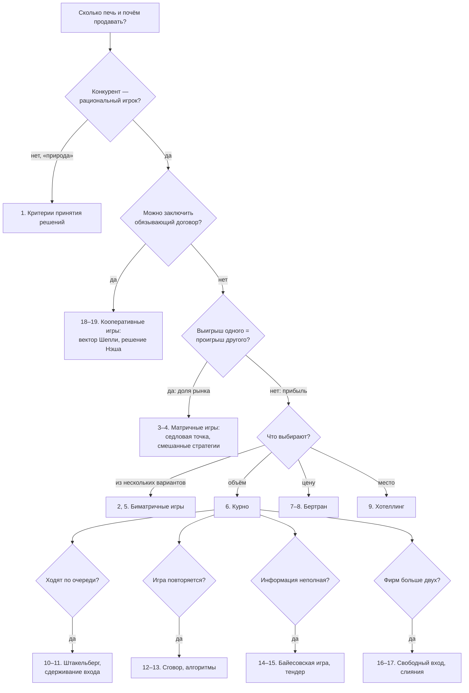

# Две пекарни: проблемная ситуация о конкуренции фирм

**Один сюжет — девятнадцать сценариев.** От сценария к сценарию меняются условия задачи: кто конкурент, что выбирают фирмы, кто ходит первым, сколько раз повторяется игра, кто что знает, сколько фирм на рынке, можно ли договориться. Вместе с условиями меняется и метод решения: критерии теории решений, матричные игры, равновесие Нэша в чистых и смешанных стратегиях, функции реакции, обратная индукция, повторяющиеся и байесовские игры, аукционы, кооперативные игры, обучение с подкреплением.

## Как устроен кейс

Все сценарии разворачиваются на одном рынке с одними и теми же числами: спрос, издержки и выигрыши согласованы между собой. Поэтому результаты разных сценариев можно сравнивать напрямую: например, увидеть, что равновесие Курно из сценария 6 совпадает с решением матричной игры из сценария 2, а цена, которую выучили алгоритмы в сценарии 13, лежит между равновесной ценой и ценой сговора из сценария 8.

Каждый сценарий построен одинаково:

- **Что изменилось** — какое условие базовой задачи мы поменяли.
- **Проблемный вопрос** — вопрос, который стоит задать студентам до решения.
- **Модель** — игроки, стратегии, выигрыши, порядок ходов, информация.
- **Метод** — какой инструмент теории игр подходит и почему именно он.
- **Решение** — пошагово, с выкладками и числами.
- **Ответ** и **смысл результата**.
- **Типичные ошибки**.
- **Что если…** — какое следующее изменение условий ведёт к следующему сценарию.

Все расчёты проверены численно. Для чтения нужны матрицы, производные и элементарная теория вероятностей.

### Условные обозначения

| Знак | Смысл |
|---|---|
| 📌 | вывод, который стоит записать |
| ⚠️ | место, где чаще всего ошибаются |
| ✏️ | задание для студентов |
| 💬 | вопрос для обсуждения |

## Базовая ситуация

В новом микрорайоне «Сосновый» работают две пекарни — **«Рассвет»** и **«Колос»**. Обе пекут одинаковый «городской батон». Каждая пекарня каждый день решает, сколько батонов испечь и почём их продавать.

**Спрос микрорайона.** Если на рынке за день продаётся $Q$ батонов, то цена, по которой их раскупят, равна

$$P = 120 - 0{,}1\,Q \qquad\Longleftrightarrow\qquad Q = 1200 - 10P.$$

При цене 120 рублей батон не покупает никто. Каждый рубль снижения цены добавляет 10 покупок в день.

**Издержки.** Мука, энергия и упаковка обходятся в $c = 30$ рублей на батон у каждой пекарни. Постоянные издержки (аренда, зарплата) не влияют на ежедневный выбор и учитываются только там, где речь идёт о входе на рынок (сценарии 11 и 16).

**Прибыль пекарни** $i$ при выпуске $q_i$:

$$\pi_i = (P - c)\,q_i = \bigl(120 - 0{,}1(q_1 + q_2) - 30\bigr)\,q_i = \bigl(90 - 0{,}1(q_1 + q_2)\bigr)\,q_i.$$

Все деньги — в рублях в день, если не сказано иное.

### Три ориентира

Прежде чем вводить конкуренцию, полезно знать два крайних случая. Они будут линейками, по которым мы измеряем все сценарии.

| Структура рынка | Выпуск $Q$ | Цена $P$ | Прибыль отрасли | Излишек покупателей | Общее благосостояние |
|---|---|---|---|---|---|
| Монополия (или картель двух пекарен) | 450 | 75 | 20 250 | 10 125 | 30 375 |
| Равновесие Курно (сценарий 6) | 600 | 60 | 18 000 | 18 000 | 36 000 |
| Совершенная конкуренция | 900 | 30 | 0 | 40 500 | 40 500 |

Монопольный выпуск находится из условия $\frac{d}{dQ}\bigl[(90 - 0{,}1Q)Q\bigr] = 90 - 0{,}2Q = 0$, откуда $Q = 450$. При совершенной конкуренции цена равна издержкам: $120 - 0{,}1Q = 30$, откуда $Q = 900$. Излишек покупателей — площадь треугольника под кривой спроса над ценой: $CS = \tfrac12 (120 - P)\,Q$.

📌 Любой исход конкуренции двух пекарен лежит между монополией (цена 75) и совершенной конкуренцией (цена 30). Вопрос каждого сценария — где именно и почему.

### Проблемная ситуация

Владелец «Рассвета» приходит к консультанту с простым вопросом: **«Сколько мне печь и почём продавать?»** Консультант отвечает: «Это зависит от того, что вы знаете о "Колосе" и как устроена ваша конкуренция». Владелец удивлён: задача ведь одна и та же.

💬 Задайте этот вопрос студентам до любой теории. Соберите ответы и предположения. Почти всегда звучат три типа ответов: «печь столько же, сколько вчера», «печь больше конкурента, чтобы забрать рынок», «договориться с конкурентом». Каждый из них — один из сценариев ниже, и каждый верен при своих условиях.

## Переключатели условий

Ответ на вопрос владельца зависит от семи «переключателей». Каждый сценарий поворачивает один или два из них.

| Переключатель | Варианты | Сценарии |
|---|---|---|
| Кем считать конкурента | неопределённостью («природой») / рациональным игроком | 1 / 2 и далее |
| Что делят фирмы | постоянный пирог (доля рынка) / прибыль, которая может расти у обеих | 3–4 / остальные |
| Что выбирают | один из нескольких вариантов / объём / цену / место | 2, 5 / 6, 10, 16 / 7, 8 / 9 |
| Кто ходит первым | одновременно / по очереди | большинство / 10, 11 |
| Сколько раз | однократно / изо дня в день | большинство / 12, 13 |
| Кто что знает | всё / не знает издержек соперника | большинство / 14, 15 |
| Сколько фирм и можно ли договориться | две / много; без договора / обязывающий договор | 16, 17 / 18, 19 |



## Обозначения

| Символ | Значение |
|---|---|
| $q_i$ | выпуск пекарни $i$, батонов в день |
| $Q = q_1 + q_2$ | общий выпуск |
| $p_i$ | цена пекарни $i$, рублей за батон |
| $P(Q) = 120 - 0{,}1Q$ | обратная функция спроса |
| $c = 30$ | издержки на один батон |
| $\pi_i$ | прибыль пекарни $i$, рублей в день |
| $R_i(\cdot)$ | функция реакции (лучший ответ) пекарни $i$ |
| $F$ | постоянные издержки в день (аренда, персонал) |
| $\delta$ | коэффициент дисконтирования: насколько завтрашний рубль ценится сегодня |
| $p$, $q$ | вероятности в смешанных стратегиях (в сценариях 4–5) |
| $v$ | цена антагонистической игры |
| $CS$, $W$ | излишек покупателей и общественное благосостояние |

⚠️ Буквы $p$ и $q$ в сценариях 4–5 означают вероятности, а в остальных — цены и объёмы. Контекст всегда разводит эти значения, но студентам об этом стоит сказать заранее.

***

# Часть I. Конкурент: неопределённость или игрок?

Первые два сценария решают одну и ту же задачу с одной и той же таблицей чисел. Разница только в том, как «Рассвет» думает о «Колосе». Это самый наглядный способ показать, чем теория игр отличается от теории принятия решений.

## Сценарий 1. Конкурент как «природа»: выбор в условиях неопределённости

**Что изменилось.** Владелец «Рассвета» не пытается понять логику «Колоса». Для него завтрашний выпуск конкурента — такая же неопределённость, как погода. Он выбирает один из трёх объёмов:

- 200 батонов — осторожный вариант;
- 300 батонов — средний;
- 450 батонов — агрессивный, столько выпускал бы монополист.

«Колос» может испечь те же 200, 300 или 450 батонов, но вероятности неизвестны.

**Проблемный вопрос.** 💬 Если ничего не знать о конкуренте, какой объём выбрать? Есть ли «правильный» ответ без дополнительных предположений?

**Модель.** Это игра с природой: одно лицо, принимающее решение, и неизвестное состояние среды. Выигрыш «Рассвета» при объёмах $q_1$ и $q_2$:

$$\pi_1 = \bigl(90 - 0{,}1(q_1 + q_2)\bigr)\,q_1.$$

Посчитаем одну клетку для примера. «Рассвет» печёт 300, «Колос» — 200. Всего 500 батонов, цена $120 - 50 = 70$, наценка $70 - 30 = 40$, прибыль $40 \cdot 300 = 12\,000$.

Матрица выигрышей «Рассвета», тысяч рублей в день:

| «Рассвет» / «Колос» печёт | 200 | 300 | 450 |
|---|---|---|---|
| 200 | 10 | 8 | 5 |
| 300 | 12 | 9 | 4,5 |
| 450 | 11,25 | 6,75 | 0 |

**Метод.** Критерии принятия решений в условиях неопределённости. Каждый критерий формализует своё отношение к незнанию.

**Решение.**

*Критерий Вальда (максимин) — крайний пессимизм.* Для каждой альтернативы берём худший исход и выбираем альтернативу с наилучшим худшим исходом.

| Объём | Худший исход | |
|---|---|---|
| 200 | 5 | ← максимум |
| 300 | 4,5 | |
| 450 | 0 | |

Выбор — 200 батонов: гарантированные 5 тысяч, что бы ни сделал «Колос».

*Максимакс — крайний оптимизм.* Берём лучший исход каждой альтернативы: 10; 12; 11,25. Выбор — 300.

*Критерий Лапласа — принцип недостаточного основания.* Раз нет причин считать одно состояние вероятнее другого, считаем их равновероятными и сравниваем средние:

$$\bar\pi(200) = \tfrac{10 + 8 + 5}{3} = 7{,}67, \quad \bar\pi(300) = \tfrac{12 + 9 + 4{,}5}{3} = 8{,}5, \quad \bar\pi(450) = \tfrac{11{,}25 + 6{,}75 + 0}{3} = 6.$$

Выбор — 300.

*Критерий Сэвиджа — минимакс сожалений.* Сожаление — сколько мы недополучили по сравнению с лучшим решением при данном состоянии природы. Сначала в каждом столбце находим максимум: 12; 9; 5. Затем вычитаем каждый элемент из максимума своего столбца:

| «Рассвет» / «Колос» печёт | 200 | 300 | 450 | Максимальное сожаление |
|---|---|---|---|---|
| 200 | 2 | 1 | 0 | 2 |
| 300 | 0 | 0 | 0,5 | **0,5** |
| 450 | 0,75 | 2,25 | 5 | 5 |

Выбираем строку с наименьшим максимальным сожалением — 300.

*Критерий Гурвица — компромисс.* Пусть $\alpha$ — коэффициент пессимизма, $0 \le \alpha \le 1$. Оценка альтернативы — взвешенная сумма худшего и лучшего исходов:

$$H = \alpha \cdot \min + (1 - \alpha) \cdot \max.$$

$$H(200) = 10 - 5\alpha, \qquad H(300) = 12 - 7{,}5\alpha, \qquad H(450) = 11{,}25(1 - \alpha).$$

При $\alpha = 0{,}5$: 7,5; 8,25; 5,625 — выбор 300. Граница между 200 и 300: $10 - 5\alpha = 12 - 7{,}5\alpha$, откуда $\alpha = 0{,}8$. Очень осторожный владелец ($\alpha > 0{,}8$) выберет 200, остальные — 300. Альтернатива 450 не выигрывает ни при каком $\alpha$.

⚠️ В учебниках встречаются обе записи: через коэффициент пессимизма и через коэффициент оптимизма $\lambda = 1 - \alpha$. Перед решением договоритесь, какая используется.

*Критерий Байеса — вероятности известны.* Пусть маркетолог оценил: «Колос» печёт 200 с вероятностью 0,3, 300 — с вероятностью 0,5, 450 — с вероятностью 0,2. Ожидаемая прибыль:

$$E(200) = 0{,}3 \cdot 10 + 0{,}5 \cdot 8 + 0{,}2 \cdot 5 = 8{,}0; \quad E(300) = 3{,}6 + 4{,}5 + 0{,}9 = 9{,}0; \quad E(450) = 3{,}375 + 3{,}375 + 0 = 6{,}75.$$

Выбор — 300. Если бы «Колос» с вероятностью больше 2/3 пёк 450 (а иначе 300), лучшим стал бы объём 200: $8 - 3r > 9 - 4{,}5r$ при $r > 2/3$.

**Ответ.**

| Критерий | Отношение к неопределённости | Выбор |
|---|---|---|
| Вальд | худший случай | 200 |
| Максимакс | лучший случай | 300 |
| Лаплас | все состояния равновероятны | 300 |
| Сэвидж | избегаем сожаления | 300 |
| Гурвиц | компромисс, $\alpha \le 0{,}8$ / $\alpha > 0{,}8$ | 300 / 200 |
| Байес | известные вероятности (0,3; 0,5; 0,2) | 300 |

**Смысл результата.** 📌 В игре с природой нет единственного «правильного» решения: критерий выражает отношение лица, принимающего решение, к незнанию. Пессимист печёт 200, потому что боится, что «Колос» завалит рынок хлебом. Но разумно ли этого бояться? Здесь заканчивается теория решений и начинается теория игр.

**Типичные ошибки.**

- ⚠️ В критерии Сэвиджа вычитать из максимума строки, а не столбца. Сожаление считается при фиксированном состоянии природы, то есть по столбцу.
- ⚠️ Путать коэффициент пессимизма и оптимизма в критерии Гурвица.
- ⚠️ Применять критерий Байеса, когда вероятностей на самом деле нет: «равные вероятности» — это уже критерий Лапласа, а не знание.

**Что если…** «Колос» — не погода, а такой же расчётливый владелец с такой же таблицей? Тогда некоторые его варианты можно исключить заранее. Это сценарий 2.

***

## Сценарий 2. Конкурент как рациональный игрок: доминирование и равновесие Нэша

**Что изменилось.** «Рассвет» понимает, что «Колос» тоже считает прибыль и выбирает объём из тех же трёх вариантов. Игра симметрична: таблица «Колоса» такая же.

**Проблемный вопрос.** 💬 Станет ли разумный «Колос» печь 450 батонов? Если нет, нужен ли «Рассвету» осторожный вариант 200?

**Модель.** Биматричная игра 3×3. В каждой клетке — выигрыши (прибыль «Рассвета» ; прибыль «Колоса»), тысяч рублей в день:

| «Рассвет» / «Колос» | 200 | 300 | 450 |
|---|---|---|---|
| 200 | (10 ; 10) | (8 ; 12) | (5 ; 11,25) |
| 300 | (12 ; 8) | (9 ; 9) | (4,5 ; 6,75) |
| 450 | (11,25 ; 5) | (6,75 ; 4,5) | (0 ; 0) |

**Метод.** Итеративное исключение строго доминируемых стратегий, затем проверка равновесия Нэша через лучшие ответы.

**Решение.**

*Шаг 1. Объём 450 строго доминируется объёмом 300.* Сравним строки «Рассвета»: против 200 — $12 > 11{,}25$; против 300 — $9 > 6{,}75$; против 450 — $4{,}5 > 0$. При любом выборе «Колоса» 300 лучше, чем 450. Рациональный игрок 450 не выберет. Игра симметрична, поэтому «Колос» тоже не выберет 450.

*Шаг 2. В оставшейся игре 2×2 объём 300 доминирует 200.* Без 450 у «Рассвета» строки: 200 → (10; 8), 300 → (12; 9). Против 200: $12 > 10$; против 300: $9 > 8$. Это требует следующего уровня рассуждения: «я знаю, что "Колос" рационален и не испечёт 450».

*Шаг 3. Результат:* (300; 300), прибыль по 9 тысяч.

*Проверка через лучшие ответы.* Лучший ответ на 200 — 300 (12 больше 10 и 11,25). Лучший ответ на 300 — 300 (9 больше 8 и 6,75). Лучший ответ на 450 — 200 (5 больше 4,5 и 0). Единственная клетка, где оба играют лучший ответ друг на друга, — (300; 300). Это единственное равновесие Нэша.

**Ответ.** 📌 Рациональные пекарни пекут по 300 батонов, цена 60 рублей, прибыль по 9 000 рублей в день. Это равновесие Курно, которое в сценарии 6 мы получим уже без перебора вариантов.

**Смысл результата.**

Первое. Пессимист из сценария 1 выбирал 200, потому что боялся объёма 450. Но 450 — доминируемая стратегия: рациональный конкурент её не выберет. 📌 Моделирование конкурента как рационального игрока отсекает неправдоподобные угрозы и меняет решение.

Второе. Внутри этой игры сидит дилемма заключённого. Если бы обе пекарни пекли по 200, каждая получила бы 10 тысяч вместо 9. Но исход (200; 200) неустойчив: каждой выгодно испечь 300 и получить 12. Расставим числа по ролям дилеммы: искушение $T = 12$, награда за сотрудничество $R = 10$, наказание $P = 9$, выигрыш обманутого $S = 8$. Порядок $T > R > P > S$ выполнен.

Третье, для психологов. Критерий Лапласа из сценария 1 дал 300. Его можно прочитать как лучший ответ на конкурента, который выбирает наугад. В поведенческой теории игр такое рассуждение называют мышлением первого уровня (level-1): игрок нулевого уровня действует случайно, игрок первого уровня отвечает на него наилучшим образом. Здесь мышление первого уровня совпало с равновесием, но в общем случае это не так. Эксперименты Р. Нагель (1995) показывают, что большинство людей проводят один-два шага такого рассуждения, а не бесконечную цепочку «я знаю, что ты знаешь…».

**Типичные ошибки.**

- ⚠️ Исключать стратегию, которая хуже «в среднем» или «в большинстве случаев». Строгое доминирование требует, чтобы она была хуже при *каждом* выборе соперника.
- ⚠️ Считать (200; 200) решением, потому что там у обоих больше. Это эффективный исход, но не равновесие.

**Что если…** Пекарни встречаются на рынке каждый день. Сможет ли угроза завтрашней мести удержать их на 200? Это сценарий 12. А что если пекарни делят не прибыль, а постоянное число покупателей? Это сценарии 3–4.

***

# Часть II. Борьба за долю рынка: антагонистические игры

В части I прибыль могла вырасти у обеих пекарен сразу. Теперь поменяем условие: пекарни делят постоянное число покупателей. Сколько получил один, столько потерял другой. Такие игры называются антагонистическими, или играми с нулевой (постоянной) суммой, и для них есть собственный, очень сильный аппарат.

## Сценарий 3. Маркетинговая кампания: седловая точка

**Что изменилось.** Цены на батон одинаковые (60 рублей), а общий спрос микрорайона фиксирован: 600 батонов в день. Пекарни на месяц выбирают маркетинговую кампанию, которая перераспределяет покупателей. Выигрыш — доля рынка «Рассвета» в процентах; доля «Колоса» — остаток до 100 %.

Стратегии «Рассвета»: А1 — скидка по карте, А2 — реклама в соцсетях, А3 — новый сорт хлеба. Стратегии «Колоса»: Б1 — скидка по карте, Б2 — реклама, Б3 — доставка на дом.

**Проблемный вопрос.** 💬 «Рассвету» нужна наибольшая доля, «Колосу» — наименьшая доля «Рассвета». Есть ли такая пара кампаний, от которой никому не выгодно отступать?

**Модель.** Матрица долей «Рассвета», %:

| | Б1 | Б2 | Б3 | Минимум строки |
|---|---|---|---|---|
| А1 | 45 | 62 | 47 | 45 |
| А2 | 55 | 58 | **52** | **52** |
| А3 | 60 | 42 | 44 | 42 |
| Максимум столбца | 60 | 62 | **52** | |

Поскольку доли в сумме дают 100 %, игра с постоянной суммой эквивалентна игре с нулевой суммой: достаточно вычесть из каждой клетки 50.

**Метод.** Принцип максимина для антагонистических игр: нижняя и верхняя цена игры, седловая точка.

**Решение.**

*Шаг 1. Проверим доминирование.* Ни одна строка не лучше другой во всех столбцах: например, А2 лучше А1 против Б1 (55 > 45), но хуже против Б2 (58 < 62). Ни один столбец не лучше другого для «Колоса» (он хочет поменьше): Б3 лучше Б1 против А2 (52 < 55), но хуже против А1 (47 > 45). Доминирование задачу не решает.

*Шаг 2. Нижняя цена игры — гарантия «Рассвета».* Рассуждение осторожного «Рассвета»: «Что бы я ни выбрал, "Колос" ответит худшим для меня образом. Выберу кампанию, у которой худший случай лучше всех». Минимумы строк: 45; 52; 42. Нижняя цена

$$\underline{v} = \max_i \min_j a_{ij} = 52 \quad (\text{стратегия А2}).$$

*Шаг 3. Верхняя цена игры — гарантия «Колоса».* «Колос» рассуждает зеркально: «Что бы я ни выбрал, "Рассвет" ответит лучшим для себя образом. Выберу кампанию, при которой его лучший ответ даёт ему меньше всего». Максимумы столбцов: 60; 62; 52. Верхняя цена

$$\overline{v} = \min_j \max_i a_{ij} = 52 \quad (\text{стратегия Б3}).$$

*Шаг 4. Седловая точка.* Нижняя и верхняя цены совпали: $\underline{v} = \overline{v} = 52$. Клетка (А2; Б3) — наименьшая в своей строке и наибольшая в своём столбце. Это седловая точка, а 52 % — цена игры.

*Проверка устойчивости.* Если «Колос» играет Б3, лучший ответ «Рассвета» — А2: 52 больше 47 и 44. Если «Рассвет» играет А2, лучший ответ «Колоса» — Б3: 52 меньше 55 и 58. Никому не выгодно отступать в одиночку — это равновесие Нэша.

**Ответ.** 📌 «Рассвет» вкладывается в рекламу, «Колос» — в доставку. Доли 52 % и 48 %: 312 и 288 батонов в день, или 9 360 и 8 640 рублей прибыли при наценке 30 рублей.

**Смысл результата.**

В антагонистической игре равновесие совпадает с парой осторожных (максиминных) стратегий. Здесь не нужно угадывать соперника: осторожная стратегия одновременно и равновесная. Если седловых точек несколько, цена игры у них одна и та же, а стратегии взаимозаменяемы. Это сильные свойства, которых в неантагонистических играх нет: в сценарии 2 осторожный выбор (200) не совпадал с равновесием (300).

💬 Насколько реалистично предположение о постоянной сумме? Оно верно, только если общий спрос не зависит от действий пекарен: цены фиксированы, а реклама лишь перераспределяет покупателей. Если реклама приводит новых покупателей, сумма перестаёт быть постоянной, и мы возвращаемся к части I.

**Типичные ошибки.**

- ⚠️ Для «Колоса» искать минимум по столбцу. В матрице записан выигрыш «Рассвета», «Колос» его *минимизирует*, поэтому по столбцам считают максимумы, а потом берут наименьший из них.
- ⚠️ Решить, что седловая точка есть всегда. Проверка обязательна: $\underline{v} = \overline{v}$.

**Что если…** Доставка на дом запрещена санитарными правилами, и у «Колоса» остаются только Б1 и Б2. Тогда минимумы строк: 45; 55; 42, нижняя цена 55. Максимумы столбцов: 60; 62, верхняя цена 60. $55 < 60$ — седловой точки нет. Решение существует только в смешанных стратегиях: «Рассвет» играет А2 с вероятностью 6/7 и А3 — с вероятностью 1/7, «Колос» — Б1 с вероятностью 16/21 и Б2 — с вероятностью 5/21, цена игры $390/7 \approx 55{,}7$ %. Как такое решение находить — в сценарии 4.

***

## Сценарий 4. Акционные дни: смешанные стратегии

**Что изменилось.** Пекарни каждую неделю выбирают, когда проводить акцию. У «Рассвета» два варианта: А1 — акция в будни, А2 — акция в выходные. У «Колоса» три: Б1 — в будни, Б2 — в выходные, Б3 — постоянная программа лояльности вместо акций. Выигрыш — по-прежнему доля «Рассвета», %.

**Проблемный вопрос.** 💬 Если «Рассвет» всегда проводит акцию в будни, «Колос» быстро это заметит. Что делать, если любая предсказуемая стратегия проигрывает?

**Модель.**

| | Б1 | Б2 | Б3 | Минимум строки |
|---|---|---|---|---|
| А1 | 40 | 60 | 58 | 40 |
| А2 | 70 | 40 | 50 | 40 |
| Максимум столбца | 70 | 60 | 58 | |

Нижняя цена 40, верхняя 58. $40 < 58$ — седловой точки нет. Если «Рассвет» всегда играет А1, «Колос» отвечает Б1, и доля «Рассвета» падает до 40 %. Если всегда А2 — «Колос» отвечает Б2, снова 40 %.

**Метод.** Смешанные стратегии: «Рассвет» выбирает А1 с вероятностью $p$ и А2 с вероятностью $1 - p$. По теореме фон Неймана о минимаксе (1928) в смешанных стратегиях нижняя и верхняя цены совпадают. Для игры 2×n удобен графический метод, для любой игры — линейное программирование.

**Решение графическим методом.**

*Шаг 1. Ожидаемая доля «Рассвета» против каждой чистой стратегии «Колоса».*

$$L_1(p) = 40p + 70(1 - p) = 70 - 30p \quad (\text{против Б1}),$$

$$L_2(p) = 60p + 40(1 - p) = 40 + 20p \quad (\text{против Б2}),$$

$$L_3(p) = 58p + 50(1 - p) = 50 + 8p \quad (\text{против Б3}).$$

*Шаг 2. Гарантия «Рассвета» при данном $p$* — худшая из трёх прямых, то есть нижняя огибающая $\min\{L_1, L_2, L_3\}$: «Колос» ответит тем, что для «Рассвета» хуже всего.


*Шаг 3. Ищем наивысшую точку нижней огибающей.* При $p = 0$ огибающая идёт по $L_2$ (40), растёт, пока не встретит убывающую $L_1$:

$$70 - 30p = 40 + 20p \;\Rightarrow\; p^* = 0{,}6, \qquad v = 70 - 18 = 52.$$

Прямая $L_3$ в этой точке выше: $L_3(0{,}6) = 54{,}8 > 52$. Значит, Б3 в решении не участвует.

*Шаг 4. Стратегия «Колоса».* Он смешивает только активные стратегии Б1 и Б2: Б1 с вероятностью $q$, Б2 — с вероятностью $1 - q$. Вероятность $q$ подбирается так, чтобы «Рассвету» было всё равно, что выбирать:

$$40q + 60(1 - q) = 70q + 40(1 - q) \;\Rightarrow\; 60 - 20q = 40 + 30q \;\Rightarrow\; q^* = 0{,}4.$$

Проверка: при $q = 0{,}4$ стратегия А1 даёт $16 + 36 = 52$, стратегия А2 — $28 + 24 = 52$.

**Ответ.** 📌 «Рассвет» проводит акцию в будни в 60 % недель и в выходные — в 40 %, выбирая неделю случайно. «Колос» — в будни в 40 % недель, в выходные в 60 %, программу лояльности не вводит. Цена игры — 52 %: столько «Рассвет» гарантирует себе в среднем, и больше «Колос» ему не позволит.

**Решение через линейное программирование.** Для игр больше 2×n графический метод не работает, а линейное программирование — работает всегда. Задача «Рассвета»:

$$\max v \quad \text{при} \quad 40p_1 + 70p_2 \ge v, \quad 60p_1 + 40p_2 \ge v, \quad 58p_1 + 50p_2 \ge v, \quad p_1 + p_2 = 1, \quad p_1, p_2 \ge 0.$$

Классическая замена $x_i = p_i / v$ (цена игры положительна) даёт стандартную задачу: минимизировать $x_1 + x_2$ при $40x_1 + 70x_2 \ge 1$, $60x_1 + 40x_2 \ge 1$, $58x_1 + 50x_2 \ge 1$, $x \ge 0$. Тогда $v = 1/(x_1 + x_2)$ и $p_i = x_i v$. Задача «Колоса» — двойственная к ней.

```python
import numpy as np
from scipy.optimize import linprog

A = np.array([[40, 60, 58],
              [70, 40, 50]])           # доля «Рассвета», строки — его стратегии
m, n = A.shape
# переменные: p_1..p_m, v; максимизируем v  <=>  минимизируем -v
res = linprog(c=np.r_[np.zeros(m), -1],
              A_ub=np.hstack([-A.T, np.ones((n, 1))]), b_ub=np.zeros(n),  # v - p·A_j <= 0
              A_eq=[np.r_[np.ones(m), 0]], b_eq=[1],
              bounds=[(0, None)] * m + [(None, None)])
print(res.x)   # [0.6 0.4 52.]
```

Задача «Колоса» решается так же и даёт $q = (0{,}4;\ 0{,}6;\ 0)$, $v = 52$.

**Смысл результата.**

📌 В антагонистической игре без седловой точки непредсказуемость — часть оптимальной стратегии. Это объясняет, почему магазины устраивают распродажи в случайные дни: если акция предсказуема, конкурент на неё отвечает (модель распродаж Х. Вэриана, 1980).

Обратите внимание на Б3. Ни одна чистая стратегия «Колоса» её не доминирует: против А1 она лучше Б2 (58 < 60), против А2 — лучше Б1 (50 < 70). Но её доминирует *смесь*: 20 % Б1 и 80 % Б2 дают «Рассвету» $(56;\ 46)$, что меньше $(58;\ 50)$ в обоих случаях. Графический метод находит такие стратегии автоматически.

**Типичные ошибки.**

- ⚠️ Брать пересечение любых двух прямых. Нужна наивысшая точка *нижней огибающей*, а не самое высокое пересечение: точка $L_2 = L_3$ (p = 5/6, 56,7 %) выше, но «Колос» её не допустит.
- ⚠️ Подставлять в смесь «Колоса» неактивную стратегию Б3.
- ⚠️ Понимать смешанную стратегию как «половину акции в будни, половину в выходные» в одну неделю. Вероятность относится к выбору, а не к дозировке действия.

**Что если…** Интересы пекарен не строго противоположны: обе могут выиграть, если разойдутся по разным нишам. Тогда смешанные стратегии снова появятся, но устроены будут иначе. Это сценарий 5.

***

# Часть III. Когда равновесий несколько

## Сценарий 5. Выбор ниши: премиум или эконом

**Что изменилось.** Пекарни выбирают концепцию на год вперёд. «Премиум» — хлеб на закваске, дорогой и с высокой наценкой. «Эконом» — массовый батон. Ниши разной ёмкости, и в одной нише двум пекарням тесно.

Прибыль в тысячах рублей в день:

- одна пекарня в премиуме — 16, одна в экономе — 10;
- обе в премиуме — по 6: маленький сегмент делится пополам, и начинается ценовая борьба;
- обе в экономе — по 4: та же борьба, но с низкой наценкой.

**Проблемный вопрос.** 💬 Обе пекарни хотят в премиум. Чем закончится, если они выбирают одновременно и не договариваются?

**Модель.** Биматричная игра 2×2, выигрыши (прибыль «Рассвета» ; прибыль «Колоса»):

| «Рассвет» / «Колос» | Премиум | Эконом |
|---|---|---|
| Премиум | (6 ; 6) | (16 ; 10) |
| Эконом | (10 ; 16) | (4 ; 4) |

**Метод.** Поиск всех равновесий Нэша: чистых — через лучшие ответы, смешанного — через принцип безразличия. Затем — способы выбрать одно из нескольких равновесий.

**Решение.**

*Шаг 1. Доминирующей стратегии нет.* Премиум лучше, если конкурент в экономе ($16 > 4$), но хуже, если конкурент в премиуме ($6 < 10$).

*Шаг 2. Лучшие ответы.* На «Премиум» лучший ответ — «Эконом» (10 > 6). На «Эконом» — «Премиум» (16 > 4). Каждой пекарне выгодно поступить не так, как конкурент. Это игра антикоординации, родственная игре «Ястребы и голуби».

*Шаг 3. Чистые равновесия.* Их два: (Премиум; Эконом) с выигрышами (16; 10) и (Эконом; Премиум) с выигрышами (10; 16). В каждом пекарни разошлись по нишам, но конфликт остался: обе предпочли бы быть той, что в премиуме.

*Шаг 4. Смешанное равновесие.* Пусть конкурент выбирает премиум с вероятностью $q$. Тогда

$$E(\text{Премиум}) = 6q + 16(1 - q) = 16 - 10q, \qquad E(\text{Эконом}) = 10q + 4(1 - q) = 4 + 6q.$$

Пекарня смешивает, только если ей всё равно: $16 - 10q = 4 + 6q$, откуда $q^* = 3/4$. Игра симметрична, поэтому обе выбирают премиум с вероятностью 3/4. Ожидаемая прибыль каждой: $16 - 7{,}5 = 8{,}5$ тысячи.

Вероятность столкнуться в одной нише: $\left(\tfrac34\right)^2 + \left(\tfrac14\right)^2 = \tfrac58$. В 62,5 % случаев пекарни мешают друг другу, и каждая получает меньше, чем в любом чистом равновесии (8,5 против 10 или 16).

**Ответ.** 📌 Три равновесия: два чистых (одна пекарня в премиуме, другая в экономе) и одно смешанное (премиум с вероятностью 3/4, ожидаемая прибыль 8,5). Сама матрица не говорит, какое из них реализуется.

**Как выбирается равновесие.**

- **Право первого хода.** Если «Рассвет» объявляет концепцию первым, решаем обратной индукцией: на «Премиум» «Колос» ответит «Экономом». «Рассвет» получает 16, «Колос» — 10. Тот, кто первым связал себя обязательством (арендовал помещение под крафтовую пекарню, заказал печь для заквасок), забирает лучшую нишу. Это преимущество первого хода — подробнее в сценарии 10.
- **Фокальная точка (Т. Шеллинг).** Асимметрия, которой нет в матрице: у «Рассвета» репутация старой пекарни, поэтому всем «очевидно», что премиум — его.
- **Посредник или общий сигнал (коррелированное равновесие, Р. Ауманн, 1974).** Администрация торгового центра распределяет ниши жребием. Ожидаемая прибыль каждой — $\tfrac12 \cdot 16 + \tfrac12 \cdot 10 = 13$, гораздо больше 8,5 в смешанном равновесии, и никто не хочет нарушать жребий: каждый исход — равновесие Нэша.

**Смысл результата.** 📌 Дифференциация выгодна обеим: разойдясь по нишам, пекарни зарабатывают 26 тысяч вместе против 12 при совпадении. Но кто получит лучшую нишу — вопрос не равновесия, а координации, обязательств и институтов. Та же идея вернётся в сценарии 9, где пекарни выбирают уже не концепцию, а место на улице.

**Типичные ошибки.**

- ⚠️ Считать (Премиум; Премиум) равновесием, «потому что премиум выгоднее». В этой клетке каждой пекарне выгодно уйти в эконом.
- ⚠️ Искать вероятность пекарни из её собственного безразличия к своим выигрышам. Вероятность $q$ подбирается так, чтобы безразличным стал *соперник*.

**Что если…** Стратегия — не выбор из двух концепций, а любое число: объём выпуска. Тогда лучший ответ ищется не перебором, а производной. Это сценарий 6.

***

# Часть IV. Непрерывные стратегии: объём, цена, место

## Сценарий 6. Модель Курно: сколько печь

**Что изменилось.** Пекарни выбирают объём выпуска — любое неотрицательное число, а не один из трёх вариантов. Батоны пекут ночью, одновременно, не зная выпуска конкурента. Утром цена складывается такой, чтобы весь хлеб раскупили: $P = 120 - 0{,}1(q_1 + q_2)$.

**Проблемный вопрос.** 💬 В сценарии 2 мы выбирали из 200, 300 и 450. Не потеряли ли мы лучший вариант, например 280 или 320?

**Модель.** Игроки — две пекарни. Стратегии — $q_1, q_2 \ge 0$. Выигрыши:

$$\pi_1 = (90 - 0{,}1q_1 - 0{,}1q_2)\,q_1 = 90q_1 - 0{,}1q_1^2 - 0{,}1q_1q_2.$$

При фиксированном $q_2$ это парабола по $q_1$ ветвями вниз.

**Метод.** Равновесие Нэша с непрерывными стратегиями: лучший ответ находим из условия первого порядка, равновесие — как пересечение функций реакции (А. Курно, 1838).

**Решение.**

*Шаг 1. Лучший ответ «Рассвета».*

$$\frac{\partial \pi_1}{\partial q_1} = 90 - 0{,}2q_1 - 0{,}1q_2 = 0 \;\Rightarrow\; R_1(q_2) = 450 - \frac{q_2}{2}.$$

Условие второго порядка: $\partial^2 \pi_1 / \partial q_1^2 = -0{,}2 < 0$ — это максимум. У «Колоса» симметрично: $R_2(q_1) = 450 - q_1/2$.

Прочитаем функцию реакции. Если «Колос» не печёт ничего, «Рассвет» становится монополистом и печёт 450. Каждый лишний батон «Колоса» уменьшает оптимальный выпуск «Рассвета» на полбатона. Если «Колос» испечёт 900, «Рассвету» печь незачем: цена упадёт до 30.

*Шаг 2. Пересечение.* В симметричном равновесии $q_1 = q_2 = q$:

$$q = 450 - \frac{q}{2} \;\Rightarrow\; q^* = 300.$$

*Шаг 3. Цена и прибыль.* $Q = 600$, $P = 120 - 60 = 60$, $\pi = (60 - 30) \cdot 300 = 9\,000$ у каждой.


**Ответ.** 📌 Каждая пекарня печёт 300 батонов, цена 60 рублей, прибыль по 9 000 рублей в день. Перебор в сценарии 2 нашёл то же самое, потому что 300 было среди вариантов.

**Смысл результата.**

*Между монополией и конкуренцией.* Выпуск 600 больше монопольного (450), но меньше конкурентного (900). Чистые потери общества от недопроизводства: при монополии $40\,500 - 30\,375 = 10\,125$, при дуополии Курно $40\,500 - 36\,000 = 4\,500$ рублей в день.

*Стратегические субституты.* Функции реакции убывают: чем больше печёт конкурент, тем меньше выгодно печь мне. Это свойство объёмной конкуренции, и в сценарии 8 мы увидим противоположное у ценовой.

*Устойчивость.* Пусть пекарни по очереди отвечают на вчерашний выпуск друг друга, начиная с «Колоса», который ничего не пёк: $450 \to 225 \to 337{,}5 \to 281{,}3 \to 309{,}4 \to 295{,}3 \to 302{,}3 \to 298{,}8 \to \dots \to 300$. Каждый шаг вдвое сокращает расстояние до равновесия, потому что наклон функции реакции по модулю меньше единицы. Равновесие не только существует, но и достижимо простым приспособлением.

*Разные издержки.* Если у «Колоса» издержки 40 рублей, а у «Рассвета» 30, условия первого порядка дают общую формулу $q_i = (a - 2c_i + c_j)/(3b)$: «Рассвет» печёт 333,3, «Колос» — 233,3, цена 63,3, прибыли 11 111 и 5 444. Эффективная пекарня занимает большую долю рынка.

**Типичные ошибки.**

- ⚠️ Дифференцировать по обоим выпускам сразу, как будто «Рассвет» выбирает и свой, и чужой. Каждая пекарня оптимизирует только свою переменную.
- ⚠️ Потерять двойку: производная от $-0{,}1q_1^2$ равна $-0{,}2q_1$.
- ⚠️ Подставить в спрос $q$ вместо $Q = 2q$ при расчёте цены.

**Что если…** Пекарни назначают не объём, а цену, и пекут под заказ сколько угодно. Это сценарий 7.

***

## Сценарий 7. Модель Бертрана: ценовая война

**Что изменилось.** Пекарни объявляют цены и пекут столько, сколько закажут. Батоны одинаковые, поэтому покупатель идёт туда, где дешевле. При равных ценах покупатели делятся пополам.

**Проблемный вопрос.** 💬 Если пекарен всего две, может ли цена упасть до себестоимости?

**Модель.** Стратегии — цены $p_1, p_2$. Прибыль «Рассвета»:

$$\pi_1 = \begin{cases} (p_1 - 30)(1200 - 10p_1), & p_1 < p_2,\\ \tfrac12 (p_1 - 30)(1200 - 10p_1), & p_1 = p_2,\\ 0, & p_1 > p_2. \end{cases}$$

Функция прибыли разрывна: стоит опустить цену на копейку ниже конкурента — и забираешь весь рынок.

**Метод.** Равновесие Нэша, найденное перебором случаев. ⚠️ Условие первого порядка здесь неприменимо: функция прибыли не дифференцируема в точке $p_1 = p_2$.

**Разминка: два ценника.** Пусть цен всего две — «высокая» 75 и «обычная» 60. Выигрыши в тысячах рублей в день:

| «Рассвет» / «Колос» | 75 | 60 |
|---|---|---|
| 75 | (10,125 ; 10,125) | (0 ; 18) |
| 60 | (18 ; 0) | (9 ; 9) |

Обычная цена строго доминирует: $18 > 10{,}125$ и $9 > 0$. Это снова дилемма заключённого: $T = 18 > R = 10{,}125 > P = 9 > S = 0$.

**Решение для непрерывных цен.** Докажем, что единственное равновесие — $p_1 = p_2 = 30$. Переберём все возможные пары цен.

1. Кто-то назначает цену ниже 30. Он продаёт в убыток и выиграет, подняв цену до 30. Не равновесие.
2. $p_1 > p_2 > 30$. «Рассвет» ничего не продаёт; назначив цену чуть ниже $p_2$, он заберёт весь рынок с положительной наценкой. Не равновесие.
3. $p_1 = p_2 = p > 30$. Каждая получает половину рынка. Снизив цену на копейку, пекарня получит почти весь рынок — прибыль почти удвоится. Не равновесие.
4. $p_1 > p_2 = 30$. «Колос» продаёт всё, но без прибыли. Подняв цену чуть ниже $p_1$, он сохранит покупателей и получит прибыль. Не равновесие.
5. $p_1 = p_2 = 30$. Обе продают по себестоимости, прибыль 0. Повышение цены — ноль продаж, снижение — убытки. **Равновесие.**

**Ответ.** 📌 Цена 30, выпуск 900, прибыль 0. Двух фирм достаточно, чтобы получить исход совершенной конкуренции. Это парадокс Бертрана (Ж. Бертран, 1883).

**Варианты условий.**

*Разные издержки.* Пусть у «Колоса» старая печь и издержки 36 рублей. Тогда «Рассвет» назначает цену чуть ниже 36, например 35,99. «Колос» не может опуститься ниже без убытка и ничего не продаёт. «Рассвет» продаёт около 840 батонов и получает почти $6 \cdot 840 = 5\,040$ рублей. Монопольная цена «Рассвета» (75) выше 36, поэтому его сдерживают именно издержки конкурента.

*Ограниченные мощности.* Пусть каждая печь выпекает не больше 300 батонов. Проверим, будет ли равновесием цена 60, при которой спрос как раз равен суммарной мощности: $1200 - 10 \cdot 60 = 600$.

- Снижать цену бессмысленно: больше 300 всё равно не испечь.
- Повышать цену: часть покупателей уйдёт к конкуренту, но он обслужит только 300. Остаточный спрос «Рассвета» — $q_1 = (1200 - 10p_1) - 300 = 900 - 10p_1$. Прибыль $(p_1 - 30)(900 - 10p_1)$ максимальна при $900 - 20p_1 + 300 = 0$, то есть при $p_1 = 60$.

Цена 60 — равновесие, и это в точности исход Курно. Д. Крепс и Х. Шейнкман (1983) доказали общий результат: если фирмы сначала выбирают мощности, а потом конкурируют ценами, получается исход Курно. 📌 Курно — модель для отраслей, где мощность выбирают заранее (хлеб испечён до открытия). Бертран — для отраслей, где можно продать сколько угодно по объявленной цене.

**Смысл результата.** 💬 Почему на самом деле пекарни не продают батон по себестоимости? Мы уже нашли три ответа и найдём ещё один: ограниченные мощности (только что), различия в хлебе (сценарий 8), место (сценарий 9), повторяющееся взаимодействие (сценарий 12).

**Типичные ошибки.**

- ⚠️ Решать модель Бертрана через производную — функция прибыли разрывна.
- ⚠️ Считать, что «чуть ниже конкурента» — это равновесие при любой цене. Подрезание продолжается, пока цена не дойдёт до издержек.

**Что если…** Хлеб у пекарен разный, и часть покупателей не уйдёт к конкуренту из-за пары рублей. Это сценарий 8.

***

## Сценарий 8. Разный хлеб: цены при дифференциации товара

**Что изменилось.** «Рассвет» печёт ржаной, «Колос» — пшеничный. Хлеб частично заменим: если «Колос» дорожает, часть его покупателей переходит в «Рассвет», но не все. Спрос на хлеб «Рассвета»:

$$q_1 = 600 - 10p_1 + 5p_2, \qquad q_2 = 600 - 10p_2 + 5p_1.$$

При равных ценах $p_1 = p_2 = p$ общий спрос $q_1 + q_2 = 1200 - 10p$ — тот же, что в базовой задаче. Меняется только то, как покупатели делятся при разных ценах.

**Проблемный вопрос.** 💬 Если «Колос» поднимет цену, что выгоднее «Рассвету» — поднять свою или опустить?

**Модель.** Стратегии — цены. Прибыль «Рассвета»:

$$\pi_1 = (p_1 - 30)(600 - 10p_1 + 5p_2).$$

**Метод.** Равновесие Нэша через условия первого порядка. Теперь функция прибыли гладкая, и производная применима.

**Решение.**

*Шаг 1. Лучший ответ.*

$$\frac{\partial \pi_1}{\partial p_1} = (600 - 10p_1 + 5p_2) - 10(p_1 - 30) = 900 - 20p_1 + 5p_2 = 0 \;\Rightarrow\; R_1(p_2) = 45 + \frac{p_2}{4}.$$

*Шаг 2. Пересечение.* $p = 45 + p/4$, откуда $p^* = 60$.

*Шаг 3. Объём и прибыль.* $q = 600 - 600 + 300 = 300$, $\pi = 30 \cdot 300 = 9\,000$.

*Шаг 4. Для сравнения — сговор.* Если пекарни согласуют одну цену $p$, каждая получает $(p - 30)(600 - 5p)$. Максимум при $600 - 10p + 150 = 0$, то есть $p = 75$, $q = 225$, $\pi = 10\,125$ — ровно монопольный исход. Но сговор неустойчив: на цену конкурента 75 лучший ответ $R_1(75) = 63{,}75$, и нарушитель получает 11 391 рубль, а обманутый — 7 594.


**Ответ.** 📌 Цены по 60, объёмы по 300, прибыли по 9 000. Дифференциация спасает прибыль, которую в сценарии 7 уничтожила ценовая война.

**Смысл результата.**

*Стратегические комплементы.* Функция реакции по цене возрастает: если «Колос» дорожает, «Рассвету» тоже выгодно поднять цену. В модели Курно было наоборот. Это различие определяет многое: в ценовой конкуренции выгодно быть ведомым (сценарий 10), а слияния выгоднее, чем в объёмной (сценарий 17).

*Совпадение чисел — не случайность.* Спрос подобран так, что равновесие (60; 300; 9 000) и сговор (75; 225; 10 125) совпадают с моделью Курно. Это позволяет сравнивать сценарии напрямую: разница между ними — в форме конкуренции, а не в рынке.

**Типичные ошибки.**

- ⚠️ Забыть, что цена конкурента входит в мой спрос со знаком плюс.
- ⚠️ При дифференцировании произведения потерять слагаемое $-10(p_1 - 30)$.

**Что если…** Хлеб одинаковый, но пекарни стоят в разных местах, и покупателю приходится идти. Тогда «дифференциация» — это расстояние. Это сценарий 9.

***

## Сценарий 9. Где открыть пекарню: модель Хотеллинга

**Что изменилось.** Микрорайон вытянут вдоль улицы длиной 1 км. На ней равномерно живут 600 семей, каждая покупает один батон в день в ближайшей пекарне. Пекарни выбирают, где открыться. Сначала цены одинаковые — 60 рублей, затем добавим ценовую конкуренцию.

**Проблемный вопрос.** 💬 Где поставить две пекарни, чтобы людям было удобнее? А где их поставят сами владельцы?

**Модель.** Места $x_1, x_2 \in [0;\ 1]$ км. При фиксированной цене выигрыш — число покупателей. Покупатель идёт к ближайшей пекарне, поэтому граница между «территориями» проходит посередине между пекарнями.

**Метод.** Равновесие Нэша в пространственной конкуренции (Г. Хотеллинг, 1929): лучший ответ находим рассуждением, а не производной, потому что выигрыш скачет при совпадении мест.

**Решение при одинаковых ценах.**

*Шаг 1. Лучший ответ.* Пусть «Колос» стоит в точке $x_2 = 0{,}3$. Если «Рассвет» встанет правее, например в $0{,}31$, ему достанется всё от середины $0{,}305$ до конца улицы: 69,5 % покупателей. Чем ближе он к «Колосу» с более длинной стороны, тем больше его доля.

*Шаг 2. Равновесие.* Пока пекарни стоят не в центре, одной выгодно сдвинуться к другой с длинной стороны. Устойчиво только положение, где обе стоят в центре улицы: $x_1 = x_2 = 0{,}5$, по 300 покупателей. Отойти в любую сторону — значит отдать конкуренту больше половины улицы.

*Шаг 3. Сравним с удобством жителей.* Если поставить пекарни в точках 0,25 и 0,75 км, средний путь покупателя — 125 м. Если обе стоят в центре — 250 м, вдвое больше. При этом доли пекарен в обоих вариантах одинаковы: по 300 семей.

**Ответ (одинаковые цены).** 📌 Обе пекарни встают в центр улицы. Это принцип минимальной дифференциации: конкуренты «слипаются», хотя обществу выгоднее их развести.

**Решение при ценовой конкуренции.** Пусть пекарни уже стоят на концах улицы (0 и 1 км) и конкурируют ценами. Дорога до пекарни обходится покупателю в $t = 30$ рублей за каждый километр расстояния (время и усилия). Покупатель в точке $x$ безразличен, если

$$p_1 + 30x = p_2 + 30(1 - x) \;\Rightarrow\; x = \frac{p_2 - p_1 + 30}{60}.$$

Спрос «Рассвета» — $600x = 10(p_2 - p_1 + 30)$, прибыль $\pi_1 = 10(p_1 - 30)(p_2 - p_1 + 30)$. Условие первого порядка:

$$(p_2 - p_1 + 30) - (p_1 - 30) = 0 \;\Rightarrow\; R_1(p_2) = 30 + \frac{p_2}{2}.$$

В симметричном равновесии $p = 30 + p/2$, откуда $p^* = 60 = c + t$. Каждая пекарня обслуживает 300 семей и получает 9 000 рублей.

| Цена дороги $t$, руб/км | 10 | 20 | 30 | 50 |
|---|---|---|---|---|
| Равновесная цена $c + t$ | 40 | 50 | 60 | 80 |
| Прибыль каждой | 3 000 | 6 000 | 9 000 | 15 000 |

📌 Наценка равна стоимости дороги между пекарнями: чем сильнее различаются предложения, тем мягче ценовая конкуренция. При $t \to 0$ модель превращается в модель Бертрана, и цена падает до 30.

**Смысл результата.** Одна улица даёт два противоположных ответа. Если цены одинаковые, пекарни слипаются в центре. Если пекарни конкурируют ценами, им выгодно разойтись, чтобы смягчить ценовую войну: К. д'Аспремон, Ж. Габшевич и Ж.-Ф. Тисс (1979) показали, что при квадратичных затратах на дорогу пекарни расходятся к концам улицы (принцип максимальной дифференциации). Та же логика объясняет, почему похожие магазины стоят рядом, а предвыборные программы двух партий сближаются к позиции медианного избирателя (Э. Даунс, 1957).

**Типичные ошибки.**

- ⚠️ Считать, что каждая пекарня обслуживает отрезок до соседней пекарни. Граница проходит посередине между ними.
- ⚠️ Решать задачу о месте производной: при совпадении мест выигрыш скачет.

**Что если…** Одна пекарня открывается раньше и печёт хлеб, пока другая ещё решает, сколько печь. Это сценарий 10.

***

# Часть V. Кто ходит первым

## Сценарий 10. Модель Штакельберга: преимущество первого хода

**Что изменилось.** «Рассвет» начинает печь в четыре утра, и к тому времени, когда «Колос» решает, сколько печь, хлеб «Рассвета» уже лежит на витрине. Объём лидера известен ведомому и изменить его нельзя.

**Проблемный вопрос.** 💬 Выгодно ли ходить первым, если конкурент увидит твой ход и ответит на него наилучшим образом?

**Модель.** Последовательная игра с непрерывными стратегиями. Сначала «Рассвет» выбирает $q_1$, затем «Колос», зная $q_1$, выбирает $q_2$. Выигрыши — как в модели Курно.

**Метод.** Обратная индукция: сначала решаем задачу ведомого для любого $q_1$, затем подставляем его ответ в задачу лидера (Г. фон Штакельберг, 1934).

**Решение.**

*Шаг 1. Ведомый.* «Колос» видит $q_1$ и отвечает лучшим образом — это его функция реакции из сценария 6:

$$q_2 = R_2(q_1) = 450 - \frac{q_1}{2}.$$

*Шаг 2. Лидер.* «Рассвет» знает, как ответит «Колос», и подставляет этот ответ в свою прибыль:

$$\pi_1 = \bigl(90 - 0{,}1q_1 - 0{,}1(450 - 0{,}5q_1)\bigr)\,q_1 = (45 - 0{,}05q_1)\,q_1.$$

Максимум: $45 - 0{,}1q_1 = 0$, откуда $q_1 = 450$.

*Шаг 3. Ответ ведомого и итоги.* $q_2 = 450 - 225 = 225$; $Q = 675$; $P = 120 - 67{,}5 = 52{,}5$; $\pi_1 = 22{,}5 \cdot 450 = 10\,125$; $\pi_2 = 22{,}5 \cdot 225 = 5\,062{,}5$.

| | Курно (одновременно) | Штакельберг (по очереди) | Изменение |
|---|---|---|---|
| Выпуск «Рассвета» | 300 | 450 | +50 % |
| Выпуск «Колоса» | 300 | 225 | −25 % |
| Цена | 60 | 52,5 | −12,5 % |
| Прибыль «Рассвета» | 9 000 | 10 125 | +12,5 % |
| Прибыль «Колоса» | 9 000 | 5 062,5 | −43,75 % |
| Излишек покупателей | 18 000 | 22 781 | +26,6 % |

**Ответ.** 📌 Лидер печёт 450 и получает 10 125, ведомый печёт 225 и получает 5 062,5. Ходить первым в объёмной конкуренции выгодно.

**Смысл результата.**

*Почему лидер выигрывает.* Лидер использует знание о реакции ведомого: если испечь больше, ведомый испечёт меньше (функция реакции убывает). Обратите внимание: точка (450; 225) не лежит на функции реакции «Рассвета» — на выпуск 225 его лучший ответ был бы $R_1(225) = 337{,}5$. Лидер «переплачивает» объёмом, и это работает только потому, что хлеб уже испечён. 📌 Преимущество первого хода — это преимущество обязательства: ход должен быть необратимым и видимым.

*А если ходить первым ценой?* Возьмём спрос сценария 8 и пусть «Рассвет» первым объявляет цену. Ведомый отвечает по $R_2(p_1) = 45 + p_1/4$. Лидер максимизирует $(p_1 - 30)\bigl(600 - 10p_1 + 5(45 + p_1/4)\bigr)$ и получает $p_1 = 435/7 \approx 62{,}14$. Ведомый ставит $p_2 \approx 60{,}54$, немного дешевле лидера.

| Ценовое лидерство | Цена | Объём | Прибыль |
|---|---|---|---|
| «Рассвет» (лидер) | 62,14 | 281,3 | 9 040 |
| «Колос» (ведомый) | 60,54 | 305,4 | 9 324 |

Ведомый зарабатывает *больше* лидера: он знает цену лидера и слегка её подрезает. 📌 При стратегических субститутах (объёмы) выгодно ходить первым, при стратегических комплементах (цены) — вторым.

**Типичные ошибки.**

- ⚠️ Решать задачу лидера при фиксированном $q_2$ — так снова получается Курно. Лидер подставляет в свою прибыль *функцию* $R_2(q_1)$, а не число.
- ⚠️ Считать, что первому ходить выгодно всегда. В ценовой игре это не так.

**Что если…** «Колос» ещё не открылся и только решает, входить ли на рынок. Может ли «Рассвет» использовать своё право первого хода, чтобы его не пустить? Это сценарий 11.

***

## Сценарий 11. Новый конкурент: вход на рынок и его сдерживание

**Что изменилось.** «Рассвет» пока один в микрорайоне и работает как монополист: 450 батонов по 75 рублей, прибыль 20 250 в день. «Колос» думает, открываться ли. Открытие требует постоянных издержек $F$ в день: аренда, персонал, оборудование.

**Проблемный вопрос.** 💬 «Рассвет» заявляет: «Если "Колос" откроется, я обрушу цены». Стоит ли «Колосу» бояться? И что может сделать «Рассвет», чтобы угроза стала настоящей?

### 11.1. Угроза ценовой войны

**Модель.** Игра в развёрнутой форме. Выигрыши (прибыль «Колоса» ; прибыль «Рассвета»):

```
                         «Колос»
                  /                  \
           Не входить               Войти
         (0 ; 20 250)                 |
                                  «Рассвет»
                               /             \
                       Мириться            Воевать
                  (Курно, сценарий 6)   (Бертран, сценарий 7)
                  (9 000 − F ; 9 000)      (−F ; 0)
```

**Метод.** Обратная индукция и проверка правдоподобия угроз (совершенное подыгровое равновесие Р. Зельтена).

**Решение.** После входа «Рассвет» сравнивает: мириться — 9 000, воевать — 0. Он будет мириться. Предвидя это, «Колос» входит, если $9\,000 - F > 0$, то есть при $F < 9\,000$. Угроза ценовой войны неправдоподобна: исполнять её невыгодно самому «Рассвету».

📌 Слова о войне ничего не стоят. Сдержать вход может только то, что меняет собственные выигрыши «Рассвета» после входа.

### 11.2. Обязательство через объём

**Что меняется.** «Рассвет» заранее связывает себя объёмом $q_1$: заключает долгосрочные договоры с магазинами на поставку или ставит печи и нанимает пекарей под этот выпуск. Отыграть назад нельзя. «Колос» видит $q_1$ и решает, входить ли и сколько печь.

**Метод.** Модель Штакельберга со входом (идеи М. Спенса, 1977, и А. Диксита, 1980): обратная индукция с непрерывной стратегией лидера.

**Решение.**

*Шаг 1. Что получит «Колос», если войдёт.* Его лучший ответ $q_2 = 450 - q_1/2$, его операционная прибыль

$$\pi_2^*(q_1) = \bigl(90 - 0{,}1q_1 - 0{,}1q_2\bigr)q_2 = \frac{(900 - q_1)^2}{40}.$$

Он входит, только если $\pi_2^*(q_1) > F$.

*Шаг 2. Какой объём закрывает вход.* Вход невыгоден, если $(900 - q_1)^2/40 \le F$, то есть при

$$q_1 \ge q_L = 900 - \sqrt{40F}.$$

Это лимитный выпуск: столько нужно печь, чтобы новичку не хватило места.

*Шаг 3. Три режима.*

| Издержки входа $F$ | Что делает «Рассвет» | Выпуск | Цена | Прибыль «Рассвета» |
|---|---|---|---|---|
| $F \ge 5\,062{,}5$ — вход блокирован | ведёт себя как монополист: даже при 450 «Колосу» не окупиться | 450 | 75 | 20 250 |
| $434 \le F < 5\,062{,}5$ — вход сдержан | печёт лимитный объём $q_L$ больше монопольного | $900 - \sqrt{40F}$ | ниже 75 | $(90 - 0{,}1q_L)\,q_L$ |
| $F < 434$ — вход допущен | сдерживать слишком дорого; впускает и становится лидером Штакельберга | 450 | 52,5 | 10 125 |

Граница 5 062,5 — это прибыль ведомого при $q_1 = 450$: $(900 - 450)^2/40$. Граница 434 — точка, где прибыль от сдерживания падает до 10 125, прибыли лидера Штакельберга: $s(900 - 10s) = 10\,125$ при $s = \sqrt{0{,}4F}$ даёт $s \approx 13{,}18$ и $F = s^2/0{,}4 \approx 434$.

*Пример: $F = 1\,000$.* Лимитный выпуск $q_L = 900 - \sqrt{40\,000} = 700$, цена $120 - 70 = 50$, прибыль «Рассвета» $20 \cdot 700 = 14\,000$. Это больше, чем 10 125 при допуске. «Колос», войдя, получил бы $(900 - 700)^2/40 - 1\,000 = 0$ и не входит.


**Ответ.** 📌 При $F = 1\,000$ «Рассвет» печёт 700 батонов и продаёт по 50 рублей: он сознательно переходит монопольный объём, чтобы не пустить конкурента. Угроза стала правдоподобной, потому что объём заранее зафиксирован.

**Смысл результата.**

*Покупатели выигрывают от угрозы входа.* Даже если «Колос» так и не откроется, цена падает с 75 до 50: монополиста дисциплинирует сама возможность конкуренции. Это идея теории состязательных рынков.

*Связь с задачей 9 лаборатории.* В задаче «Вход на рынок» угроза борьбы тоже была неправдоподобной. Здесь показано, как превратить слова в обязательство: изменить свои будущие выигрыши заранее.

**Типичные ошибки.**

- ⚠️ Считать прибыль входящего по модели Курно. После обязательства «Рассвета» «Колос» отвечает на зафиксированный $q_1$, это модель Штакельберга.
- ⚠️ Забывать, что сдерживать выгодно не всегда: при малых $F$ лимитный объём слишком велик, и выгоднее впустить.

**Что если…** Обе пекарни уже работают и встречаются на рынке каждый день, бесконечно. Может ли повторение удержать их от войны цен? Это сценарий 12.

***

# Часть VI. Время: игра повторяется каждый день

## Сценарий 12. Молчаливый сговор

**Что изменилось.** Пекарни встречаются на рынке каждый день, и конца этому не видно. Завтрашняя прибыль ценится чуть меньше сегодняшней с коэффициентом дисконтирования $\delta$. Пекарни не заключают никаких договоров, но каждая может ответить на вчерашнее поведение соперника.

**Проблемный вопрос.** 💬 В сценарии 2 пекарни не могли удержаться на выгодном для обеих объёме 200. Изменит ли что-то угроза завтрашней мести?

**Модель.** Бесконечно повторяющаяся игра. Выигрыш за всю игру — дисконтированная сумма $\sum_{t \ge 0} \delta^t \pi_t$. Рассмотрим стратегию «мрачного триггера» (grim trigger): держаться договорённого поведения, пока никто не нарушил; после первого нарушения навсегда перейти к равновесию однократной игры.

**Метод.** Теория повторяющихся игр (Дж. Фридман, 1971; народная теорема). Сравниваем две дисконтированные суммы: «соблюдать» и «нарушить сегодня, потом наказание навсегда».

**Общая формула.** Пусть $R$ — выигрыш при соблюдении, $T$ — выигрыш нарушителя в день нарушения, $P$ — выигрыш в наказании. Соблюдать выгодно, если

$$\frac{R}{1 - \delta} \ge T + \frac{\delta P}{1 - \delta} \quad\Longleftrightarrow\quad \delta \ge \delta^* = \frac{T - R}{T - P}.$$

Числитель — сегодняшний выигрыш от нарушения, знаменатель — ежедневная потеря от наказания по сравнению с соблазном.

**Решение для четырёх вариантов условий.**

*12.1. Дискретные объёмы (сценарий 2).* Договорённость — по 200 батонов: $R = 10\,000$. Лучшее нарушение — 300 при 200 у конкурента: $T = 12\,000$. Наказание — равновесие (300; 300): $P = 9\,000$.

$$\delta^* = \frac{12\,000 - 10\,000}{12\,000 - 9\,000} = \frac{2}{3}.$$

*12.2. Непрерывные объёмы (модель Курно).* Договорённость — картель, по 225 батонов: $R = 10\,125$. Лучшее нарушение — ответ на 225 по функции реакции: $q_1 = 450 - 112{,}5 = 337{,}5$, цена $120 - 56{,}25 = 63{,}75$, $T = 33{,}75 \cdot 337{,}5 = 11\,390{,}6$. Наказание — Курно: $P = 9\,000$.

$$\delta^* = \frac{11\,390{,}6 - 10\,125}{11\,390{,}6 - 9\,000} = \frac{9}{17} \approx 0{,}53.$$

*12.3. Цены, одинаковый хлеб (модель Бертрана).* Договорённость — монопольная цена 75, каждая получает половину монопольной прибыли: $R = 10\,125$. Нарушитель на копейку дешевле забирает всё: $T \approx 20\,250$. Наказание — война цен до 30: $P = 0$.

$$\delta^* = \frac{20\,250 - 10\,125}{20\,250 - 0} = \frac12.$$

*12.4. Много пекарен.* При $n$ пекарнях в модели Бертрана договорённость даёт каждой $\pi_M / n$, а нарушитель забирает всё $\pi_M$:

$$\frac{\pi_M / n}{1 - \delta} \ge \pi_M \quad\Longleftrightarrow\quad \delta \ge 1 - \frac1n.$$

| Ситуация | $\delta^*$ |
|---|---|
| Дискретные объёмы 200/300, две пекарни | 0,667 |
| Курно, две пекарни | 0,529 |
| Курно, три пекарни | 0,571 |
| Курно, четыре пекарни | 0,610 |
| Бертран, две пекарни | 0,500 |
| Бертран, три пекарни | 0,667 |
| Бертран, пять пекарен | 0,800 |
| Бертран, десять пекарен | 0,900 |
| Два ценника 75/60 (сценарий 7) | 0,875 |

Чем больше пекарен, тем выше порог: доля в сговоре меньше, а соблазн нарушить — тот же.

**Ответ.** 📌 Сговор устойчив, если пекарни достаточно ценят будущее: для двух пекарен при $\delta \ge 1/2$ в ценовой конкуренции и $\delta \ge 9/17$ в объёмной.

**Смысл результата.**

*На бумаге сговор почти неизбежен.* Пекарни встречаются каждый день. Даже при 15 % годовых дневной коэффициент дисконтирования $\delta = 1{,}15^{-1/365} \approx 0{,}9996$ — далеко выше любого порога из таблицы.

*Почему же случаются ценовые войны?* Ответ даёт не формула, а нарушение её предпосылок:

- **Цены не видны.** Если пекарня даёт скидки кафе по договору, конкурент не сразу заметит нарушение (Дж. Стиглер, 1964).
- **Спрос колеблется.** Если продажи упали, непонятно — это нарушение конкурента или просто холодная неделя. Временные ценовые войны становятся частью равновесия (Э. Грин и Р. Портер, 1984).
- **Входят новые пекарни.** С ростом $n$ порог растёт.
- **Закон.** Картельные соглашения запрещены статьёй 11 Федерального закона от 26.07.2006 № 135-ФЗ «О защите конкуренции», а статья 11.1 запрещает и согласованные действия конкурентов.

*Для психологов.* В лабораторных экспериментах с объёмной конкуренцией молчаливый сговор возникает в основном на рынках из двух фирм и почти исчезает при четырёх и более (С. Хук, Х.-Т. Норман, Й. Окслер, 2004, «Two are few and four are many»).

*Связь с задачей 10 лаборатории.* Там был выведен тот же порог $\delta^* = (T - R)/(T - P)$ для абстрактной дилеммы. Здесь он посчитан для конкретного рынка.

**Типичные ошибки.**

- ⚠️ В модели Курно считать наказание нулевым. Наказание — это равновесие однократной игры, у Курно оно даёт 9 000, а не 0.
- ⚠️ Подставлять в знаменатель $T - S$ или $R - P$.
- ⚠️ Забывать, что наказание начинается со следующего дня — отсюда множитель $\delta$.

**Что если…** Цены назначают не владельцы, а программы, которые учатся на собственной прибыли и ничего не знают о теории игр. Это сценарий 13.

***

## Сценарий 13. Цены назначают алгоритмы

**Что изменилось.** Обе пекарни подключили программы динамического ценообразования. Каждая программа видит вчерашние цены, сегодня назначает свою и получает прибыль. Программы не общаются друг с другом, их никто не учил сговору — они просто учатся максимизировать дисконтированную прибыль методом Q-обучения.

**Проблемный вопрос.** 💬 Если две программы независимо учатся на своей прибыли, придут ли они к равновесию Нэша — или научатся «сговору», которого никто не планировал?

**Модель.** Спрос из сценария 8: $q_i = 600 - 10p_i + 5p_j$, издержки 30. Цены из сетки {45, 50, 55, 60, 65, 70, 75, 80}. Равновесие однократной игры — 60, сговор — 75. Для каждого агента:

- **состояние** — пара вчерашних цен (64 состояния);
- **действие** — сегодняшняя цена (8 вариантов);
- **награда** — прибыль за день;
- **политика** — ε-жадная по таблице $Q(s, a)$: с вероятностью $\varepsilon$ случайная цена, иначе лучшая по таблице; $\varepsilon$ убывает по мере обучения;
- **обновление** — $Q(s, a) \leftarrow Q(s, a) + \alpha\bigl(r + \gamma \max_{a'} Q(s', a') - Q(s, a)\bigr)$, где $\gamma$ играет роль коэффициента дисконтирования $\delta$.

**Метод.** Многоагентное обучение с подкреплением как способ найти, к какому исходу повторяющейся игры приходят обучающиеся игроки. Это численный эксперимент, а не вывод формулы. Он в упрощённом виде повторяет исследование Э. Кальвано и соавторов (E. Calvano, G. Calzolari, V. Denicolò, S. Pastorello, 2020).

```python
import random, math

PRICES = [45, 50, 55, 60, 65, 70, 75, 80]; K = len(PRICES)
def profit(pi, pj): return (pi - 30) * max(0, 600 - 10 * pi + 5 * pj)
PROF = [[profit(PRICES[i], PRICES[j]) for j in range(K)] for i in range(K)]

def train(seed, steps=1_500_000, alpha=0.15, gamma=0.95, beta=8e-6):
    rnd = random.Random(seed)
    q0 = [sum(PROF[i]) / K / (1 - gamma) for i in range(K)]      # стартовые оценки
    Q1 = [q0[:] for _ in range(K * K)]; Q2 = [q0[:] for _ in range(K * K)]
    s = rnd.randrange(K * K)                                      # состояние = вчерашние цены
    for t in range(steps):
        eps = math.exp(-beta * t)                                 # исследование угасает
        a1 = rnd.randrange(K) if rnd.random() < eps else max(range(K), key=Q1[s].__getitem__)
        a2 = rnd.randrange(K) if rnd.random() < eps else max(range(K), key=Q2[s].__getitem__)
        s2 = a1 * K + a2
        Q1[s][a1] += alpha * (PROF[a1][a2] + gamma * max(Q1[s2]) - Q1[s][a1])
        Q2[s][a2] += alpha * (PROF[a2][a1] + gamma * max(Q2[s2]) - Q2[s][a2])
        s = s2
    return Q1, Q2
```

После обучения агенты играют жадно (без исследования), и мы смотрим, на каких ценах они останавливаются.

**Результаты эксперимента.**

| $\gamma$ — насколько алгоритм ценит будущее | Средняя цена после обучения | Индекс прибыли $\Delta$ |
|---|---|---|
| 0 (живёт сегодняшним днём) | 60,6 | 0,06 |
| 0,5 | 60,8 | 0,08 |
| 0,8 | 63,8 | 0,40 |
| 0,95 | 65,0 | 0,56 |

Индекс $\Delta = (\pi - \pi_N)/(\pi_M - \pi_N)$ показывает, какую часть пути от равновесной прибыли ($\pi_N = 9\,000$) до прибыли сговора ($\pi_M = 10\,125$) прошли агенты: 0 — равновесие Нэша, 1 — полный сговор. Для каждого значения $\gamma$ проведено 10 запусков с разными случайными зёрнами, для $\gamma = 0{,}95$ — 16. При $\gamma = 0{,}95$ все 16 запусков пришли к цене 65 и прибыли 9 625 у каждого агента.


**Как агенты удерживают цену 65.** Цена 65 — не равновесие однократной игры: на 65 конкурента лучший ответ — 60 (прибыль 9 750 против 9 625). Почему же никто не подрезает? Проверим. Пусть после обучения первый агент один раз ставит 60. Типичная реакция второго агента: на следующий день он отвечает ценой 55–60, через один-два дня оба возвращаются к 65. Агенты выучили *наказание за отклонение* — ту же логику, что в сценарии 12, — хотя никто им её не объяснял.

**Ответ.** 📌 Независимо обучающиеся алгоритмы, которые ценят будущее, устанавливают цены выше равновесных и поддерживают их выученными наказаниями. Алгоритмы, живущие одним днём ($\gamma = 0$), приходят практически к равновесию Нэша.

**Смысл результата.**

*Это та же теория повторяющихся игр.* Параметр $\gamma$ играет роль коэффициента дисконтирования $\delta$: чем сильнее агент ценит будущее, тем выше устойчивая цена.

*Правовой вопрос.* Закон запрещает соглашения и согласованные действия людей. Если «сговор» возник между программами, которые никто не настраивал на сговор, кто за него отвечает? Это один из живых вопросов антимонопольной политики.

*Ограничения эксперимента.* Модель игрушечная: восемь цен, память в один день, полтора миллиона шагов обучения. Результат зависит от сетки цен, скорости обучения и угасания исследования. В исследовании Кальвано и соавторов алгоритмы приходили к ещё более высоким ценам и держали их наказаниями конечной длины.

✏️ Запустите код с другими $\gamma$, $\alpha$ и сеткой цен. Сравните выученные цены с порогом $\delta^* = 9/17$ из сценария 12 для этого рынка.

**Что если…** Пекарни знают друг о друге не всё: например, «Рассвет» не знает издержек «Колоса». Это сценарий 14.

***

# Часть VII. Неполная информация

## Сценарий 14. Издержки конкурента неизвестны: байесовская игра

**Что изменилось.** «Колос» поставил новую печь. Если она работает как обещано, издержки «Колоса» — 20 рублей на батон; если с перебоями — 40. Каждый вариант равновероятен. «Колос» свои издержки знает, «Рассвет» (издержки 30) — нет. Пекарни выбирают объёмы одновременно, как в модели Курно.

**Проблемный вопрос.** 💬 Сколько печь «Рассвету», если он не знает, с каким «Колосом» имеет дело? И выгодно ли «Колосу» раскрыть свои издержки?

**Модель.** Байесовская игра (Дж. Харсаньи, 1967–1968). Перед игрой «природа» выбирает тип «Колоса»: низкие издержки (L) или высокие (H) с вероятностями 1/2. Стратегия «Колоса» — план для каждого типа: $(q_{2L},\ q_{2H})$. Стратегия «Рассвета» — одно число $q_1$: он не различает типы.

**Метод.** Байесовское равновесие Нэша: каждый тип каждого игрока выбирает лучший ответ, максимизируя ожидаемую прибыль при своих представлениях о типах соперника.

**Решение.**

*Шаг 1. Лучшие ответы двух типов «Колоса».* Тип L максимизирует $(120 - 0{,}1(q_1 + q_2) - 20)\,q_2$:

$$100 - 0{,}1q_1 - 0{,}2q_{2L} = 0 \;\Rightarrow\; q_{2L} = 500 - \frac{q_1}{2}.$$

Тип H — то же с издержками 40:

$$80 - 0{,}1q_1 - 0{,}2q_{2H} = 0 \;\Rightarrow\; q_{2H} = 400 - \frac{q_1}{2}.$$

*Шаг 2. Лучший ответ «Рассвета».* Он максимизирует ожидаемую прибыль:

$$E\pi_1 = \tfrac12 (90 - 0{,}1q_1 - 0{,}1q_{2L})\,q_1 + \tfrac12 (90 - 0{,}1q_1 - 0{,}1q_{2H})\,q_1.$$

Условие первого порядка: $90 - 0{,}2q_1 - 0{,}1\,E[q_2] = 0$, то есть $q_1 = 450 - E[q_2]/2$.

*Шаг 3. Решаем систему.* $E[q_2] = \tfrac12(500 - q_1/2) + \tfrac12(400 - q_1/2) = 450 - q_1/2$. Подставляем:

$$q_1 = 450 - \frac{450 - q_1/2}{2} = 225 + \frac{q_1}{4} \;\Rightarrow\; q_1^* = 300.$$

Тогда $q_{2L}^* = 500 - 150 = 350$, $q_{2H}^* = 400 - 150 = 250$.

*Шаг 4. Исходы.*

| | «Колос» типа L (издержки 20) | «Колос» типа H (издержки 40) | В среднем |
|---|---|---|---|
| Выпуск «Рассвета» | 300 | 300 | 300 |
| Выпуск «Колоса» | 350 | 250 | 300 |
| Цена | 55 | 65 | 60 |
| Прибыль «Рассвета» | 7 500 | 10 500 | 9 000 |
| Прибыль «Колоса» | 12 250 | 6 250 | 9 250 |

**Ответ.** 📌 «Рассвет» печёт 300 батонов. «Колос» с хорошей печью — 350, с плохой — 250. Цена — 55 или 65 в зависимости от того, какая печь у «Колоса».

**Сравнение с полной информацией.** Если бы «Рассвет» знал тип «Колоса», играли бы обычного Курно с разными издержками ($q_i = (a - 2c_i + c_j)/(3b)$):

| Полная информация | «Колос» L | «Колос» H |
|---|---|---|
| Выпуск «Рассвета» | 266,7 | 333,3 |
| Выпуск «Колоса» | 366,7 | 233,3 |
| Прибыль «Рассвета» | 7 111 | 11 111 |
| Прибыль «Колоса» | 13 444 | 5 444 |

**Смысл результата.**

*Средний ответ.* «Рассвет» не может подстроиться под тип и печёт «среднее» количество. Поэтому эффективный «Колос» при неполной информации печёт меньше (350 вместо 366,7): «Рассвет» не уступил ему рынок. А неэффективный — больше (250 вместо 233,3): «Рассвет» не воспользовался его слабостью.

*Кому выгодно раскрыть информацию.* Эффективному «Колосу» раскрыть издержки выгодно: 13 444 вместо 12 250. Неэффективному — невыгодно: 5 444 вместо 6 250. Если издержки можно доказать (например, показать договор на поставку печи), происходит «раскручивание»: эффективный тип раскрывается, и тогда молчание само выдаёт неэффективного. В итоге информация раскрывается полностью (С. Гроссман, 1981; П. Милгром, 1981). Если доказать нельзя, появляются сигналы: например, демонстративно большой выпуск.

*Ценность информации для «Рассвета».* При полной информации его средняя прибыль $(7\,111 + 11\,111)/2 = 9\,111$, при неполной — 9 000. Разница — 111 рублей в день: больше этого не стоит платить за разведку издержек конкурента.

*Связь с задачей 11 лаборатории.* Там конкурент тоже не знал тип фирмы, но решение принимал только он, а поведение типов было заранее «свёрнуто» в выигрыши. Здесь оба игрока делают выбор, и стратегия «Колоса» зависит от типа — это полная байесовская игра.

**Типичные ошибки.**

- ⚠️ Давать «Колосу» один объём. Его стратегия — план для каждого типа.
- ⚠️ Подставлять за «Колоса» средние издержки 30. Для «Рассвета» при линейном спросе это случайно даёт верный выпуск 300, но объёмы и прибыли «Колоса» получаются неверными: 300 вместо 350 и 250.

**Что если…** Пекари соревнуются не на рынке, а за один контракт, и победитель забирает всё. Это сценарий 15.

***

## Сценарий 15. Тендер на поставку хлеба в школы

**Что изменилось.** Управление образования объявляет тендер на месячную поставку хлеба в школы микрорайона. Контракт получает пекарня с наименьшей заявкой. Издержки выполнения контракта у каждой пекарни свои и известны только ей: для внешнего наблюдателя они равномерно распределены от 200 до 400 тысяч рублей.

**Проблемный вопрос.** 💬 Какую цену писать в заявке: свои издержки или больше? И какой формат торгов выгоднее школам?

**Модель.** Закупочный (обратный) аукцион с закрытыми заявками и независимыми частными издержками. Рассмотрим два формата:

- **аукцион первой цены** — победитель получает сумму своей заявки;
- **аукцион второй цены (Викри)** — победитель получает сумму второй по возрастанию заявки, то есть заявки ближайшего конкурента.

**Метод.** Байесовское равновесие с непрерывными типами; теорема об эквивалентности доходов.

**Решение для аукциона второй цены.** Писать в заявке свои издержки — слабо доминирующая стратегия. Логика та же, что в задаче 5 лаборатории, только зеркальная. Заявка влияет лишь на то, выиграешь ли ты, а платёж определяет конкурент. Выигрывать выгодно, только если платёж (заявка конкурента) выше твоих издержек. Правдивая заявка обеспечивает ровно это: побеждаешь тогда и только тогда, когда конкурент дороже тебя.

**Решение для аукциона первой цены.**

*Шаг 1. Компромисс.* Чем выше заявка, тем больше заработок в случае победы, но тем меньше шанс победить. Писать свои издержки бессмысленно: победа принесёт ноль.

*Шаг 2. Угадаем и проверим равновесие.* Пусть конкурент пишет $b(c) = (c + 400)/2$. Его заявки лежат между 300 и 400. Вероятность победить с заявкой $b$:

$$\Pr(b < b_j) = \Pr\left(\frac{c_j + 400}{2} > b\right) = \Pr(c_j > 2b - 400) = \frac{400 - (2b - 400)}{200} = \frac{400 - b}{100}.$$

Ожидаемая прибыль пекарни с издержками $c$:

$$E\pi(b) = (b - c)\,\frac{400 - b}{100}.$$

Максимум: $(400 - b) - (b - c) = 0$, откуда $b = (c + 400)/2$. Наш лучший ответ совпал со стратегией конкурента — это равновесие.

*Шаг 3. Общая формула.* При $n$ участниках и издержках, равномерно распределённых на $[L;\ H]$:

$$b(c) = c + \frac{H - c}{n}.$$

Наценка равна $1/n$ расстояния от своих издержек до максимально возможных.

*Пример.* Издержки «Рассвета» — 260, «Колоса» — 300 тысяч.

| Формат | Заявка «Рассвета» | Заявка «Колоса» | Победитель | Платёж школ | Прибыль победителя |
|---|---|---|---|---|---|
| Первая цена | 330 | 350 | «Рассвет» | 330 | 70 |
| Вторая цена | 260 | 300 | «Рассвет» | 300 | 40 |

**Эквивалентность доходов.** В этом примере аукцион первой цены обошёлся школам дороже. Но в среднем форматы одинаковы. По первой цене школы платят $\frac{E[c_{\min}] + 400}{2} = \frac{266{,}7 + 400}{2} = 333{,}3$. По второй — ожидаемое значение максимума из двух издержек, $200 + \frac{2}{3} \cdot 200 = 333{,}3$. Совпадение не случайно: это теорема об эквивалентности доходов (У. Викри, 1961; Р. Майерсон, 1981; Дж. Райли и У. Самуэльсон, 1981).

**Больше участников.** Если в тендер придёт третья пекарня, равновесная заявка станет $b(c) = c + (400 - c)/3$, а ожидаемый платёж школ упадёт до 300 тысяч. Одна дополнительная пекарня экономит школам 33,3 тысячи рублей в месяц.

**Ответ.** 📌 По второй цене — писать свои издержки. По первой — писать середину между своими издержками и максимально возможными: $b = (c + 400)/2$. Школам в среднем всё равно, какой формат выбрать, но важно привлечь больше участников.

**Смысл результата.** Завышение заявки в аукционе первой цены — не жадность, а рациональный ответ на неопределённость: пекарня жертвует вероятностью победы ради наценки. Для заказчика важнее всего конкуренция: при сговоре участников (одни нарочно пишут высокие заявки, чтобы выиграл «свой») механизм ломается. Такие соглашения на торгах прямо запрещены статьёй 11 Закона № 135-ФЗ.

**Типичные ошибки.**

- ⚠️ В аукционе первой цены писать свои издержки — тогда победа ничего не даёт.
- ⚠️ Считать, что аукцион первой цены всегда дороже для заказчика. В конкретном исходе может быть по-разному, а в среднем форматы эквивалентны.

**Что если…** Пекарен в микрорайоне становится всё больше. Сколько их будет и сколько их должно быть? Это сценарий 16.

***

# Часть VIII. Сколько фирм на рынке

## Сценарий 16. Свободный вход: сколько пекарен откроется

**Что изменилось.** На рынок может войти любая пекарня, если её прибыль покроет постоянные издержки $F = 2\,000$ рублей в день. Все пекарни одинаковы и конкурируют объёмами, как в модели Курно.

**Проблемный вопрос.** 💬 Сколько пекарен откроется в микрорайоне? Столько ли, сколько нужно жителям?

**Модель.** Курно с $n$ одинаковыми пекарнями плюс решение о входе: пекарня входит, если её равновесная прибыль не меньше $F$.

**Метод.** Равновесие Курно для $n$ игроков; условие нулевой прибыли последнего вошедшего; сравнение с общественным оптимумом.

**Решение.**

*Шаг 1. Равновесие при $n$ пекарнях.* Прибыль пекарни $i$: $(90 - 0{,}1Q)\,q_i$, где $Q = q_i + \sum_{j \ne i} q_j$. Условие первого порядка:

$$90 - 0{,}1Q - 0{,}1q_i = 0.$$

В симметричном равновесии $Q = nq$, поэтому $90 - 0{,}1(n + 1)q = 0$:

$$q^* = \frac{900}{n + 1}, \qquad P^* = 30 + \frac{90}{n + 1}, \qquad \pi^* = \frac{81\,000}{(n + 1)^2}.$$

| $n$ | Выпуск каждой | Цена | Прибыль каждой | Прибыль минус $F$ | Излишек покупателей | Благосостояние $W$ |
|---|---|---|---|---|---|---|
| 1 | 450 | 75 | 20 250 | 18 250 | 10 125 | 28 375 |
| 2 | 300 | 60 | 9 000 | 7 000 | 18 000 | **32 000** |
| 3 | 225 | 52,5 | 5 062,5 | 3 062,5 | 22 781 | 31 969 |
| 4 | 180 | 48 | 3 240 | 1 240 | 25 920 | 30 880 |
| 5 | 150 | 45 | 2 250 | 250 | 28 125 | 29 375 |
| 6 | 128,6 | 42,9 | 1 653 | −347 | 29 755 | 27 673 |

*Шаг 2. Свободный вход.* Пекарни входят, пока прибыль покрывает $F$: $81\,000/(n + 1)^2 \ge 2\,000$, то есть $(n + 1)^2 \le 40{,}5$, $n \le 5$. Шестая пекарня получила бы 1 653 — меньше 2 000 — и не откроется. В равновесии **пять пекарен**, цена 45.

*Шаг 3. Общественный оптимум.* Благосостояние — излишек покупателей плюс прибыли за вычетом постоянных издержек: $W(n) = \tfrac12 (120 - P)\,Q + n(\pi - F)$. Максимум — при **двух пекарнях** (32 000), а при свободном входе их пять (29 375).


**Ответ.** 📌 Откроется пять пекарен — на три больше, чем нужно обществу.

**Смысл результата.**

*Избыточный вход (Н. Мэнкью и М. Уинстон, 1986).* Входящая пекарня считает свою прибыль, но не учитывает, что большую часть своих покупателей она *отбирает* у других пекарен, а не приводит новых. При входе третьей пекарни из её 225 батонов только 75 — новый спрос, остальные 150 переманены у соседей. Для общества это не выигрыш, а перераспределение, за которое заплачено ещё одной арендой и ещё одной печью.

*От Курно к совершенной конкуренции.* При $n \to \infty$ цена $30 + 90/(n + 1)$ стремится к издержкам. Модель Курно соединяет монополию ($n = 1$) с совершенной конкуренцией. Сравните с моделью Бертрана (сценарий 7): там хватило двух фирм, чтобы цена упала до 30.

**Типичные ошибки.**

- ⚠️ Подставлять в условие первого порядка $Q = nq$ *до* дифференцирования. Сначала берём производную по своему $q_i$, считая выпуск остальных постоянным, и только потом используем симметрию.
- ⚠️ Решать неравенство входа как равенство и получать дробное число пекарен. Ответ — наибольшее целое $n$, при котором прибыль покрывает $F$.

**Что если…** Две из трёх пекарен решают объединиться. Выгодно ли им это? Это сценарий 17.

***

## Сценарий 17. Слияние: парадокс

**Что изменилось.** В микрорайоне три одинаковые пекарни: «Рассвет», «Колос» и «Мегахлеб». «Рассвет» и «Колос» обсуждают слияние. Объединённая компания будет работать на тех же печах с теми же издержками 30.

**Проблемный вопрос.** 💬 Слияние уменьшает число конкурентов. Значит, оно обязательно выгодно тем, кто сливается?

**Модель.** Курно с тремя игроками до слияния и с двумя — после.

**Метод.** Сравнение равновесий Курно (формулы сценария 16).

**Решение.**

*До слияния, $n = 3$.* Каждая пекарня печёт 225, цена 52,5, прибыль по 5 062,5. Вместе «Рассвет» и «Колос» получают 10 125.

*После слияния, $n = 2$.* Объединённая компания — один игрок. Каждый из двух игроков печёт 300, цена 60, прибыль по 9 000.

| | До слияния | После слияния | Изменение |
|---|---|---|---|
| «Рассвет» + «Колос» | 5 062,5 + 5 062,5 = 10 125 | 9 000 | −1 125 |
| «Мегахлеб» | 5 062,5 | 9 000 | +3 937,5 |
| Цена | 52,5 | 60 | +7,5 |

**Ответ.** 📌 Слияние без экономии на издержках невыгодно самим участникам: они теряют 1 125 рублей в день. Выигрывает пекарня, которая в слиянии *не* участвовала, а проигрывают покупатели.

**Почему так.** Объединённая компания ведёт себя как одна пекарня и сокращает выпуск: 300 вместо прежних 450 на двоих. «Мегахлеб» отвечает ростом выпуска со 225 до 300 — функции реакции убывают. Выгоды от более высокой цены уходят во многом аутсайдеру. Это парадокс слияния С. Саланта, Ш. Швейцера и Р. Рейнолдса (1983).

**А если слияние даёт экономию?** Пусть объединённая компания закупает муку дешевле, и её издержки снижаются до $c_m$. Тогда это Курно с разными издержками: выпуск компании $q_m = (150 - 2c_m)/0{,}3$, прибыль $0{,}1\,q_m^2$, цена $(150 + c_m)/3$.

| Издержки после слияния $c_m$ | 30 | 27 | 25 | 20 |
|---|---|---|---|---|
| Прибыль объединённой компании | 9 000 | 10 240 | 11 111 | 13 444 |
| Выгодно ли (больше 10 125)? | нет | да | да | да |
| Цена | 60 | 59 | 58,3 | 56,7 |

Слияние окупается, если издержки падают хотя бы до 27,27 рубля, то есть на 9 %. Но цена остаётся выше прежних 52,5, пока издержки не упадут до 7,5 рубля — на 75 %. 📌 Слияние, выгодное участникам, почти всегда невыгодно покупателям, если только экономия не огромна (Дж. Фаррелл и К. Шапиро, 1990). Поэтому антимонопольные органы требуют доказать экономию, а не просто заявить о ней.

**Смысл результата.** В ценовой конкуренции с дифференцированным товаром (сценарий 8) парадокса нет: там функции реакции возрастают, аутсайдер в ответ *поднимает* цену, и слияние выгодно участникам (Р. Денекере и К. Дэвидсон, 1985). Ответ на вопрос «выгодно ли сливаться» снова зависит от того, как именно конкурируют фирмы.

**Типичные ошибки.**

- ⚠️ Считать, что объединённая компания продолжит печь 450 — сумму прежних выпусков. Она заново оптимизирует выпуск как один игрок.
- ⚠️ Забывать реакцию аутсайдера.

**Что если…** Фирмы могут заключать обязывающие договоры. Тогда вопрос уже не «кто что выберет», а «как поделить общий выигрыш». Это сценарии 18–19.

***

# Часть IX. Кооперация: когда можно договориться

До сих пор пекарни не могли заключать обязывающих договоров: каждая выбирала сама, а договорённость держалась только на угрозе (сценарий 12). Теперь договор можно подписать и исполнить через суд. Вопрос меняется: не «что выберет каждый», а «как поделить общий выигрыш». Это предмет кооперативной теории игр.

## Сценарий 18. Совместная закупка муки: вектор Шепли и ядро

**Что изменилось.** Три пекарни — «Рассвет», «Колос» и «Мегахлеб» — могут закупать муку вместе. Мельница даёт скидку за объём, поэтому чем больше покупатель, тем больше экономия. Экономия зависит от того, кто объединится (тысяч рублей в месяц):

| Коалиция | Экономия $v(S)$ |
|---|---|
| Любая пекарня в одиночку | 0 |
| «Рассвет» + «Колос» | 60 |
| «Рассвет» + «Мегахлеб» | 40 |
| «Колос» + «Мегахлеб» | 30 |
| Все трое | 90 |

«Рассвет» — самая крупная пекарня, «Мегахлеб» — самая маленькая.

**Проблемный вопрос.** 💬 Все трое вместе экономят 90 тысяч. Как их поделить, чтобы никто не захотел уйти и чтобы дележ был справедливым?

**Модель.** Кооперативная игра трёх лиц с трансферабельной полезностью, заданная характеристической функцией $v(S)$. Игроки: 1 — «Рассвет», 2 — «Колос», 3 — «Мегахлеб». Дележ — вектор $(x_1, x_2, x_3)$ с $x_1 + x_2 + x_3 = 90$.

**Метод.** Ядро (устойчивые дележи) и вектор Шепли (справедливый дележ по вкладам; Л. Шепли, 1953).

**Решение.**

*Шаг 1. Объединяться выгодно.* Игра супераддитивна: $v(123) = 90 \ge v(12) + v(3) = 60$, $\ge v(13) + v(2) = 40$, $\ge v(23) + v(1) = 30$. Большая коалиция создаёт больше всех.

*Шаг 2. Ядро — дележи, от которых никакой группе не выгодно отделиться.* Каждая коалиция должна получить не меньше, чем заработает сама:

$$x_1 + x_2 \ge 60, \qquad x_1 + x_3 \ge 40, \qquad x_2 + x_3 \ge 30, \qquad x_i \ge 0, \qquad x_1 + x_2 + x_3 = 90.$$

С учётом суммы 90 это равносильно простым ограничениям сверху: $x_3 \le 30$, $x_2 \le 50$, $x_1 \le 60$. Ядро непусто, и в нём бесконечно много дележей.

- Дележ поровну (30; 30; 30) — в ядре, но на границе: «Рассвет» и «Колос» получают ровно 60, столько же, сколько вдвоём без «Мегахлеба».
- Дележ (15; 40; 35) — не в ядре: «Рассвет» и «Колос» вместе получают 55 < 60 и предпочтут закупать вдвоём.

*Шаг 3. Вектор Шепли — средний вклад игрока по всем порядкам вступления в коалицию.* Пекарни присоединяются к закупке по очереди; каждая получает то, на сколько выросла экономия с её приходом. Усредняем по всем шести порядкам.

| Порядок вступления | Вклад «Рассвета» | Вклад «Колоса» | Вклад «Мегахлеба» |
|---|---|---|---|
| Р, К, М | 0 | 60 | 30 |
| Р, М, К | 0 | 50 | 40 |
| К, Р, М | 60 | 0 | 30 |
| К, М, Р | 60 | 0 | 30 |
| М, Р, К | 40 | 50 | 0 |
| М, К, Р | 60 | 30 | 0 |
| **Среднее** | **36,67** | **31,67** | **21,67** |

Например, в порядке «Р, М, К» «Рассвет» приходит первым и в одиночку экономит 0; «Мегахлеб» добавляет $v(13) - v(1) = 40$; «Колос» добавляет $v(123) - v(13) = 50$.

*Шаг 4. Проверка.* Сумма $36{,}67 + 31{,}67 + 21{,}67 = 90$. Ядро: $x_1 + x_2 = 68{,}3 \ge 60$, $x_1 + x_3 = 58{,}3 \ge 40$, $x_2 + x_3 = 53{,}3 \ge 30$. Вектор Шепли лежит в ядре.

**Ответ.** 📌 Справедливый дележ по Шепли: «Рассвету» 36,7 тысячи, «Колосу» 31,7, «Мегахлебу» 21,7 тысячи в месяц. Он устойчив: никакой паре невыгодно уйти.

**Смысл результата.**

*Ядро отвечает на вопрос «что устойчиво», вектор Шепли — на вопрос «что справедливо».* Ядро может содержать много дележей, а может быть пустым. Вектор Шепли существует всегда и единственен: это единственное правило, удовлетворяющее четырём аксиомам — эффективность (делится всё), симметрия (одинаковые вклады — одинаковые доли), нулевой игрок (ничего не вносящий ничего не получает), аддитивность.

*Почему «Рассвет» получает больше всех.* Он больше всех добавляет к любой коалиции: с ним пары экономят 60 и 40, без него — только 30.

💬 Почему нельзя просто делить пропорционально объёмам закупки? Можно, но такое правило не обязано попасть в ядро: если оно недодаст какой-нибудь паре, та уйдёт закупать отдельно.

**Типичные ошибки.**

- ⚠️ Считать вклады только для одного порядка вступления. Вектор Шепли — среднее по *всем* $n!$ порядкам.
- ⚠️ Путать вклад с выигрышем коалиции: вклад — это прирост $v(S \cup \{i\}) - v(S)$.

**Что если…** Договариваются две пекарни с разной силой — например, о слиянии. Тогда важно, что каждая получит, если переговоры сорвутся. Это сценарий 19.

***

## Сценарий 19. Переговоры о слиянии: решение Нэша

**Что изменилось.** В микрорайоне снова две пекарни. Издержки «Рассвета» — 30, «Колоса» — 40 рублей на батон. Они обсуждают слияние: объединённая компания будет печь всё на печах «Рассвета» и работать как монополист с прибылью 20 250 в день. Если переговоры сорвутся, пекарни продолжат конкурировать по Курно.

**Проблемный вопрос.** 💬 Как поделить 20 250 рублей в день? Поровну? Пропорционально нынешним прибылям? Или иначе?

**Модель.** Задача торга двух лиц. Множество возможных дележей: $u_1 + u_2 = 20\,250$. Точка несогласия $d$ — то, что каждый получит без сделки: прибыли в асимметричном равновесии Курно (сценарий 6) — $d_1 = 11\,111$, $d_2 = 5\,444$.

**Метод.** Решение Нэша для задачи торга (Дж. Нэш, 1950): максимизировать произведение выигрышей сверх точки несогласия.

**Решение.**

*Шаг 1. Излишек сделки.* $S = 20\,250 - (11\,111 + 5\,444) = 3\,694$ рубля в день. Именно его, а не всю прибыль, и предстоит поделить.

*Шаг 2. Решение Нэша.*

$$\max_{u_1 + u_2 = 20\,250} (u_1 - d_1)(u_2 - d_2).$$

Произведение двух неотрицательных чисел с фиксированной суммой максимально, когда они равны. Каждый получает свою точку несогласия плюс половину излишка:

$$u_1 = 11\,111 + \tfrac12 \cdot 3\,694 = 12\,958, \qquad u_2 = 5\,444 + \tfrac12 \cdot 3\,694 = 7\,292.$$

Доли в объединённой компании — 64 % и 36 %.

*Шаг 3. Неравная переговорная сила.* Если «Рассвет» сильнее в переговорах (весовой коэффициент $\alpha = 0{,}7$), обобщённое решение Нэша максимизирует $(u_1 - d_1)^{0{,}7}(u_2 - d_2)^{0{,}3}$ и даёт «Рассвету» $d_1 + 0{,}7S = 13\,697$, «Колосу» — $d_2 + 0{,}3S = 6\,553$. Переговорная сила в модели А. Рубинштейна (1982) с чередующимися предложениями — это терпение: кто меньше теряет от затягивания переговоров, тот получает больше.

**Ответ.** 📌 «Рассвет» получает 12 958, «Колос» — 7 292 рубля в день (64 % и 36 % объединённой компании). Делится не прибыль целиком, а излишек сверх того, что каждый имеет без сделки.

**Смысл результата.**

*Аксиомы.* Решение Нэша — единственное правило, которое удовлетворяет четырём требованиям: эффективность (ничего не остаётся на столе), симметрия (одинаковые позиции — одинаковые доли), независимость от единиц измерения выигрышей, независимость от посторонних альтернатив.

*Сила — в запасном варианте.* «Рассвет» получает больше не потому, что он «главный», а потому, что без сделки ему лучше: у него ниже издержки. Улучшить свою позицию на переговорах можно, улучшив точку несогласия.

*Третья сторона.* Покупатели в переговорах не участвуют, а цена после слияния вырастет с 63,3 до 75. Именно поэтому такие сделки проверяет антимонопольный орган: выгодный для участников договор может быть невыгоден обществу (сравните со сценарием 17).

**Типичные ошибки.**

- ⚠️ Делить пополам всю прибыль 20 250, забыв о точке несогласия: «Рассвет» на это не согласится, ведь без сделки он получает 11 111 > 10 125.
- ⚠️ Делить пропорционально нынешним прибылям: это не решение Нэша и, вообще говоря, не следует из его аксиом.

***

# Итоги

## Сводная таблица: одно условие — один метод

| № | Что изменилось | Тип игры | Метод | Главный результат |
|---|---|---|---|---|
| 1 | Конкурент — «природа» | игра с природой | критерии Вальда, Лапласа, Сэвиджа, Гурвица, Байеса | выбор зависит от критерия: 200 или 300 |
| 2 | Конкурент — рациональный игрок | биматричная 3×3 | итеративное исключение доминируемых стратегий | (300; 300), внутри — дилемма заключённого |
| 3 | Делят постоянный рынок | антагонистическая | максимин, седловая точка | (А2; Б3), доля 52 % |
| 4 | Нет седловой точки | антагонистическая | смешанные стратегии, графический метод, ЛП | p = 0,6; q = (0,4; 0,6; 0); v = 52 % |
| 5 | Выбор ниши | биматричная 2×2, антикоординация | лучшие ответы, принцип безразличия, обязательство | 2 чистых равновесия + смешанное (3/4) |
| 6 | Объём — любое число | Курно | функции реакции, условие первого порядка | 300 и 300, цена 60, прибыль 9 000 |
| 7 | Выбирают цену, хлеб одинаковый | Бертран | перебор случаев | цена 30, прибыль 0; с мощностями — снова 60 |
| 8 | Хлеб разный | Бертран с дифференциацией | функции реакции по цене | цена 60, стратегические комплементы |
| 9 | Выбирают место | Хотеллинг | пространственная конкуренция | центр улицы; при ценовой конкуренции $p = c + t$ |
| 10 | Один ходит первым | Штакельберг | обратная индукция | лидер 450 и 10 125; в ценах выгоднее быть вторым |
| 11 | Конкурент решает, входить ли | динамическая игра входа | совершенное подыгровое равновесие, обязательство | угроза войны пуста; лимитный выпуск 700 при $F = 1\,000$ |
| 12 | Игра повторяется | бесконечно повторяющаяся | триггерные стратегии, порог $\delta^*$ | сговор устойчив при $\delta \ge 1/2$ (цены), $9/17$ (объёмы) |
| 13 | Цены назначают алгоритмы | повторяющаяся, обучение | Q-обучение | цена 65 вместо 60, выученные наказания |
| 14 | Издержки конкурента неизвестны | байесовская | байесовское равновесие Нэша | 300; 350 / 250; ценность информации 111 |
| 15 | Тендер за один контракт | аукцион | равновесные заявки, эквивалентность доходов | $b = (c + 400)/2$; средний платёж 333,3 |
| 16 | Вход свободный, фирм много | Курно с $n$ игроками | условие нулевой прибыли, благосостояние | откроется 5, нужно 2 |
| 17 | Две из трёх сливаются | Курно 3 → 2 | сравнение равновесий | слияние без экономии невыгодно участникам |
| 18 | Совместная закупка | кооперативная, 3 игрока | ядро, вектор Шепли | 36,7 / 31,7 / 21,7 |
| 19 | Переговоры о слиянии | торг двух лиц | решение Нэша | 12 958 / 7 292 |

📌 Главный вывод кейса: метод определяется не сюжетом, а условиями. Один и тот же рынок хлеба требует то критериев теории решений, то матричных игр, то производных, то обратной индукции, то вероятностей, то кооперативных решений. Научиться видеть, какое условие задачи «переключилось», — и есть главное умение, которое тренирует этот кейс.

## Связь с интерактивной лабораторией

| Задача лаборатории | Сценарий кейса | Что общего |
|---|---|---|
| 1. Дилемма заключённого | 2, 7 (два ценника) | дилемма внутри конкуренции |
| 3. Ястребы и голуби | 5 | антикоординация, смешанное равновесие |
| 5. Аукцион второй цены | 15 | правдивая заявка в аукционе Викри |
| 6. Ценовая конкуренция | 7 | дилемма цен |
| 7. Координация агентов RL | 13 | обучение в повторяющейся игре |
| 8. Орёл и решка | 4 | смешанные стратегии в антагонистической игре |
| 9. Вход на рынок | 11 | неправдоподобная угроза, обратная индукция |
| 10. Повторяющаяся дилемма | 12 | порог $\delta^* = (T - R)/(T - P)$ |
| 11. Вход при неполной информации | 14 | неполная информация о типе конкурента |
| 12. Дуополия Курно | 6, 16 | функции реакции, $n$ фирм |

## Как провести занятие

**Создание проблемной ситуации (10 минут).** Расскажите сюжет и задайте вопрос владельца «Рассвета»: «Сколько мне печь и почём продавать?». Соберите ответы студентов, не оценивая их. Затем произнесите ответ консультанта: «Это зависит от того, что вы знаете о "Колосе" и как устроена ваша конкуренция». Попросите группу перечислить, от чего именно может зависеть ответ. Обычно студенты сами находят 4–5 из 7 переключателей. Это и есть план дальнейшей работы.

**Вариант А. Одно занятие, 90 минут: «один рынок — пять методов».**

| Этап | Сценарий | Время |
|---|---|---|
| Проблемная ситуация, переключатели | введение | 10 мин |
| Конкурент как неопределённость | 1 | 15 мин |
| Конкурент как игрок | 2 | 15 мин |
| Непрерывный выпуск | 6 | 20 мин |
| Первый ход | 10 | 15 мин |
| Повторение | 12 | 15 мин |

Сквозной вопрос занятия: почему ответ меняется от 200 к 300, от 300 к 450 и обратно к «договориться на 225»?

**Вариант Б. Цикл семинаров.** Одна часть кейса — один семинар: I (сценарии 1–2), II (3–4), III–IV (5–9), V (10–11), VI (12–13), VII (14–15), VIII–IX (16–19).

**Вариант В. Проектная работа «Переключатель».** Каждая малая группа получает карточку с одним переключателем и базовую ситуацию. Задача группы: сформулировать новый вариант условий, выбрать метод, решить и представить решение. Остальные группы по постановке угадывают, какой переключатель повёрнут и какой метод понадобится. Решения сверяются с кейсом.

**Как задавать вопросы.** Перед каждым сценарием задавайте проблемный вопрос из его описания и давайте 2–3 минуты на гипотезы. Решение показывайте только после того, как прозвучали хотя бы две разные гипотезы: на столкновении версий и держится проблемное обучение.

## Задания для самостоятельной работы

1. **Сценарий 1.** Какой объём выберет «Рассвет» по критерию Гурвица при $\alpha = 0{,}9$? А по критерию Байеса, если «Колос» печёт 300 с вероятностью 0,2 и 450 — с вероятностью 0,8?
2. **Сценарий 3.** Пусть в клетке (А2; Б3) стоит 56 вместо 52. Есть ли седловая точка? Если нет — найдите решение в смешанных стратегиях.
3. **Сценарий 5.** Одна пекарня в премиуме зарабатывает 18 вместо 16. Найдите смешанное равновесие и ожидаемую прибыль.
4. **Сценарий 6.** Найдите равновесие Курно, если издержки обеих пекарен 36 рублей.
5. **Сценарий 9.** Найдите равновесные цены и прибыли при цене дороги $t = 20$ рублей за километр.
6. **Сценарий 10.** Найдите равновесие Штакельберга при издержках 36 рублей у обеих пекарен.
7. **Сценарий 12.** При каком коэффициенте дисконтирования устойчив ценовой сговор четырёх пекарен?
8. **Сценарий 14.** Пусть хорошая печь у «Колоса» работает с вероятностью 0,8. Найдите байесовское равновесие.
9. **Сценарий 15.** Издержки контракта равномерно распределены от 100 до 300 тысяч, участников двое. Найдите равновесную заявку в аукционе первой цены и ожидаемый платёж школ.
10. **Сценарий 16.** Сколько пекарен откроется, если постоянные издержки 1 000 рублей в день?
11. **Сценарий 18.** Пусть каждая пара пекарен экономит 70 тысяч, а все трое — 90. Найдите вектор Шепли. Непусто ли ядро?
12. **Сценарий 19.** Пусть издержки «Колоса» 36, а не 40. Найдите точку несогласия и решение Нэша.

### Ответы

1. Гурвиц при $\alpha = 0{,}9$: оценки 5,5; 5,25; 1,125 — выбор 200. Байес: $E(200) = 5{,}6$, $E(300) = 5{,}4$, $E(450) = 1{,}35$ — выбор 200.
2. Нижняя цена 55, верхняя 56 — седловой точки нет. Решение: «Рассвет» играет А2 с вероятностью 16/17 и А3 — с вероятностью 1/17; «Колос» — Б1 с вероятностью 12/17 и Б3 — с вероятностью 5/17; цена игры $940/17 \approx 55{,}3$ %.
3. $q^* = 7/9$; ожидаемая прибыль $18 - 12 \cdot 7/9 \approx 8{,}67$ тысячи.
4. $q = (120 - 36)/0{,}3 = 280$ у каждой, цена 64, прибыль $28 \cdot 280 = 7\,840$.
5. $p = c + t = 50$, прибыль $20 \cdot 300 = 6\,000$ у каждой.
6. Лидер 420, ведомый 210, цена 57, прибыли 8 820 и 4 410.
7. $\delta \ge 1 - 1/4 = 0{,}75$.
8. $q_1 = 280$, $q_{2L} = 360$, $q_{2H} = 260$.
9. $b(c) = (c + 300)/2$; ожидаемый платёж $100 + \tfrac23 \cdot 200 \approx 233{,}3$ тысячи.
10. $81\,000/(n + 1)^2 \ge 1\,000$ при $n \le 8$: откроется восемь пекарен, последняя — с нулевой экономической прибылью.
11. Вектор Шепли (30; 30; 30). Ядро пусто: из условий $x_i + x_j \ge 70$ следует $x_k \le 20$ для каждого, а сумма должна быть 90 > 60. Любой дележ кто-то оспорит, хотя всем вместе объединяться выгодно.
12. Курно: выпуски 320 и 260, цена 62, прибыли 10 240 и 6 760. Излишек $20\,250 - 17\,000 = 3\,250$. Решение Нэша: 11 865 и 8 385.

## Сводка формул

| Что | Формула |
|---|---|
| Спрос | $P = 120 - 0{,}1Q$, $Q = 1200 - 10P$ |
| Прибыль | $\pi_i = (P - c)\,q_i$ |
| Критерий Гурвица | $H = \alpha \min + (1 - \alpha)\max$, $\alpha$ — пессимизм |
| Нижняя и верхняя цена игры | $\underline v = \max_i \min_j a_{ij}$, $\overline v = \min_j \max_i a_{ij}$ |
| Смешанное равновесие 2×2 | вероятность игрока — из безразличия соперника |
| Функция реакции Курно | $q_i = (a - c - bq_j)/(2b) = 450 - q_j/2$ |
| Курно, $n$ фирм | $q = (a - c)/((n + 1)b)$, $P = (a + nc)/(n + 1)$, $\pi = (a - c)^2/((n + 1)^2 b)$ |
| Курно, разные издержки | $q_i = (a - 2c_i + c_j)/(3b)$ |
| Штакельберг | лидер $(a - c)/(2b)$, ведомый $(a - c)/(4b)$ |
| Цены, дифференциация | $p_1 = 45 + p_2/4$ |
| Хотеллинг (концы улицы) | $p = c + t$ |
| Лимитный выпуск | $q_L = 900 - \sqrt{40F}$ |
| Порог сговора | $\delta^* = (T - R)/(T - P)$; Бертран, $n$ фирм: $1 - 1/n$ |
| Байесовский Курно | $q_1 = 450 - E[q_2]/2$ |
| Аукцион первой цены, $U[L;H]$ | $b(c) = c + (H - c)/n$ |
| Вектор Шепли | $\varphi_i = \frac{1}{n!}\sum_{\text{порядки}} \bigl(v(S \cup \{i\}) - v(S)\bigr)$ |
| Решение Нэша | $u_i = d_i + \tfrac12\bigl(V - d_1 - d_2\bigr)$ |

## Литература

**Классические работы, на которые опираются сценарии**

- Cournot A. Recherches sur les principes mathématiques de la théorie des richesses. 1838. — сценарии 6, 16.
- Bertrand J. Théorie mathématique de la richesse sociale // Journal des Savants. 1883. — сценарий 7.
- Hotelling H. Stability in competition // Economic Journal. 1929. — сценарий 9.
- von Stackelberg H. Marktform und Gleichgewicht. 1934. — сценарий 10.
- von Neumann J., Morgenstern O. Theory of Games and Economic Behavior. 1944. — сценарии 3–4.
- Nash J. The bargaining problem // Econometrica. 1950; Equilibrium points in n-person games // PNAS. 1950. — сценарии 2, 19.
- Shapley L. A value for n-person games. 1953. — сценарий 18.
- Vickrey W. Counterspeculation, auctions, and competitive sealed tenders // Journal of Finance. 1961. — сценарий 15.
- Harsanyi J. Games with incomplete information played by «Bayesian» players // Management Science. 1967–1968. — сценарий 14.
- Friedman J. A non-cooperative equilibrium for supergames // Review of Economic Studies. 1971. — сценарий 12.
- d'Aspremont C., Gabszewicz J., Thisse J.-F. On Hotelling's «Stability in competition» // Econometrica. 1979. — сценарий 9.
- Dixit A. The role of investment in entry-deterrence // Economic Journal. 1980. — сценарий 11.
- Kreps D., Scheinkman J. Quantity precommitment and Bertrand competition yield Cournot outcomes // Bell Journal of Economics. 1983. — сценарий 7.
- Salant S., Switzer S., Reynolds R. Losses from horizontal merger // Quarterly Journal of Economics. 1983. — сценарий 17.
- Green E., Porter R. Noncooperative collusion under imperfect price information // Econometrica. 1984. — сценарий 12.
- Mankiw N. G., Whinston M. Free entry and social inefficiency // RAND Journal of Economics. 1986. — сценарий 16.
- Huck S., Normann H.-T., Oechssler J. Two are few and four are many: number effects in experimental oligopolies // Journal of Economic Behavior & Organization. 2004. — сценарий 12.
- Calvano E., Calzolari G., Denicolò V., Pastorello S. Artificial intelligence, algorithmic pricing, and collusion // American Economic Review. 2020. — сценарий 13.

**Учебники**

- Тироль Ж. Рынки и рыночная власть: теория организации промышленности (пер. с англ.; оригинал: Tirole J. The Theory of Industrial Organization. MIT Press, 1988).
- Петросян Л. А., Зенкевич Н. А., Шевкопляс Е. В. Теория игр.
- Osborne M., Rubinstein A. A Course in Game Theory. MIT Press, 1994.

**Нормативный акт**

- Федеральный закон от 26.07.2006 № 135-ФЗ «О защите конкуренции» (статьи 11 и 11.1).
